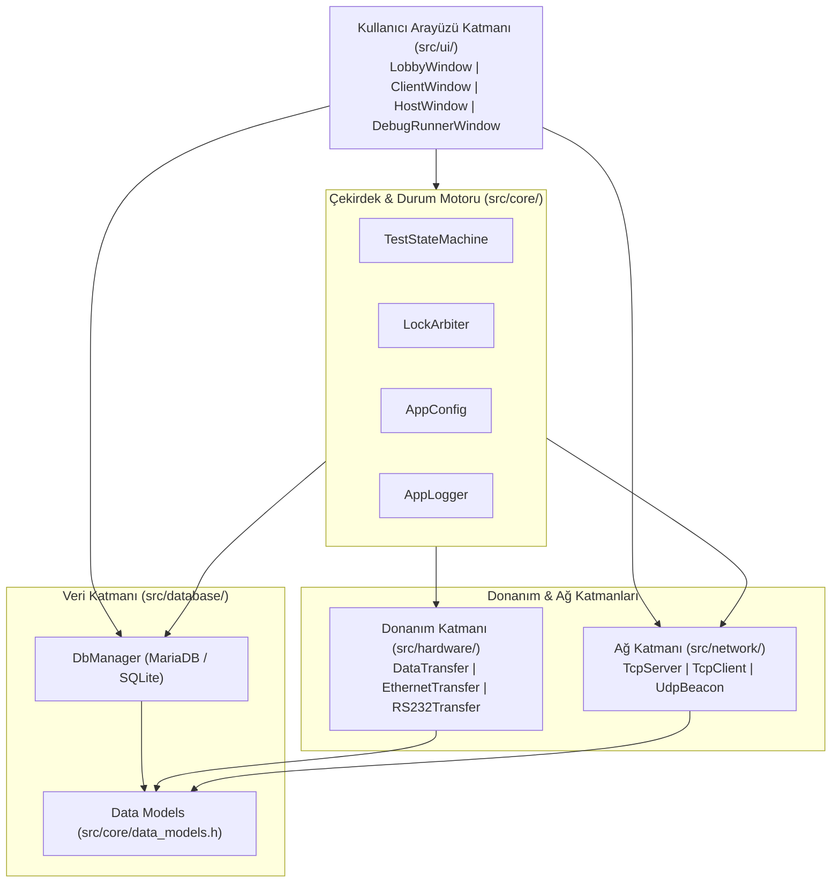
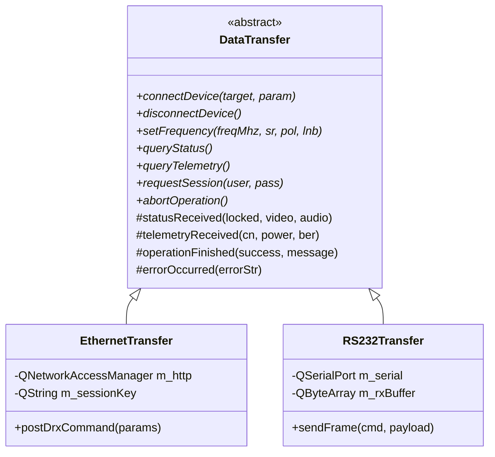

# 🛰️ NETA DRX9000 - Detaylı Kod Mimarisi ve API Rehberi

Bu belge, **NETA DRX9000 ANTENNA TEST AUTOMATION** sisteminin tüm kaynak kod tabanını, katmanlı yazılım mimarisini, C++ sınıflarını, veri modellerini, donanım haberleşme protokollerini, ağ topolojisini ve kullanıcı arayüzü bileşenlerini Doxygen standartları temelinde ayrıntılı olarak açıklamaktadır.

---

## 📑 İçindekiler
1. [Genel Mimari ve Katman Hiyerarşisi](#1-genel-mimari-ve-katman-hiyerarşisi)
2. [Çekirdek Katmanı (`src/core/`)](#2-çekirdek-katmanı-srccore)
   - [appinfo.h & build_config.h](#appinfoh--build_configh)
   - [data_models.h](#data_modelsh)
   - [AppConfig (app_config.h / .cpp)](#appconfig)
   - [AppLogger (app_logger.h / .cpp)](#applogger)
   - [LockArbiter (lock_arbiter.h / .cpp)](#lockarbiter)
   - [TestStateMachine (test_state_machine.h / .cpp)](#teststatemachine)
   - [DependencyInstaller (dependency_installer.h / .cpp)](#dependencyinstaller)
   - [XlsxUtil (xlsxutil.h / .cpp)](#xlsxutil)
3. [Veritabanı Katmanı (`src/database/`)](#3-veritabanı-katmanı-srcdatabase)
   - [DbManager (db_manager.h / .cpp)](#dbmanager)
4. [Donanım ve Haberleşme Katmanı (`src/hardware/`)](#4-donanım-ve-haberleşme-katmanı-srchardware)
   - [DataTransfer (Soyut Taban Sınıf)](#datatransfer-soyut-taban-sınıf)
   - [EthernetTransfer (Web CGI / HTTP Taşıyıcı)](#ethernettransfer-web-cgi--http-taşıyıcı)
   - [RS232Transfer (Seri Port / COM Taşıyıcı)](#rs232transfer-seri-port--com-taşıyıcı)
5. [Ağ ve Dağıtık İletişim Katmanı (`src/network/`)](#5-ağ-ve-dağıtık-iletişim-katmanı-srcnetwork)
   - [network_messages.h](#network_messagesh)
   - [UdpBeacon (udp_beacon.h / .cpp)](#udpbeacon)
   - [TcpServer (tcp_server.h / .cpp)](#tcpserver)
   - [TcpClient (tcp_client.h / .cpp)](#tcpclient)
6. [Kullanıcı Arayüzü Katmanı (`src/ui/`)](#6-kullanıcı-arayüzü-katmanı-srcui)
   - [Ortak Bileşenler (`src/ui/common/`)](#ortak-bileşenler-srcuicommon)
     - [LobbyWindow](#lobbywindow)
     - [LoginDialog & AboutDialog](#logindialog--aboutdialog)
     - [TestHistoryWidget (Geçmiş + SQL Tablo Tarayıcısı)](#testhistorywidget)
     - [ProfileManagerWidget](#profilemanagerwidget)
     - [StyleHelper & QCustomPlot](#stylehelper--qcustomplot)
   - [İstemci / Test İstasyonu Arayüzü (`src/ui/client/`)](#istemci--test-istasyonu-arayüzü-srcuiclient)
     - [ClientWindow](#clientwindow)
     - [ChannelCardWidget](#channelcardwidget)
   - [Sunucu / Yönetici Arayüzü (`src/ui/host/`)](#sunucu--yönetici-arayüzü-srcuihost)
     - [HostWindow](#hostwindow)
     - [GoldenReferenceWidget](#goldenreferencewidget)
     - [UserManagerWidget](#usermanagerwidget)
   - [Geliştirici ve Teşhis Konsolu (`src/ui/debug/`)](#geliştirici-ve-teşhis-konsolu-srcuidebug)
     - [DebugRunnerWindow (F12 Konsolu)](#debugrunnerwindow-f12-konsolu)
7. [Çoklu Algoritma Yönetimi (4 PC vs 3 PC)](#7-çoklu-algoritma-yönetimi-4-pc-vs-3-pc)
8. [Doxygen ile Dokümantasyon Üretimi](#8-doxygen-ile-dokümantasyon-üretimi)

---

## 1. Genel Mimari ve Katman Hiyerarşisi

Sistem, **Model-View-Controller (MVC)** ve **Katmanlı Servis Mimarisi (Layered Architecture)** prensiplerine göre yapılandırılmıştır.



---

## 2. Çekirdek Katmanı (`src/core/`)

### `appinfo.h` & `build_config.h`
- **`appinfo.h`**: Uygulamanın adı, sürümü (`NETA_APP_VERSION`), geliştirici (`Semi Eren Gökyıldız`), telif hakkı ve kurumsal kimlik metaverilerini barındırır. Kök dizindeki `project.ini` ve `sync_version.ps1` tarafından otomatik senkronize edilir.
- **`build_config.h`**: Projenin çalışma mimarisini seçen merkezi makro dosyasını oluşturur:
  - `#define NETA_ALGORITMA_1_FOUR_PC`: 1 Host Sunucu + 3 Test İstasyonu, TCP Mutex Hakemi.
  - `#define NETA_ALGORITMA_2_THREE_PC`: Dağıtık 3 İstasyon, MariaDB atomik satır kilitleme kuyruğu.

### `data_models.h`
Tüm sistemde paylaşılan ana veri yapılarını ve JSON serileştirme fonksiyonlarını içerir:
- **`TransponderConfig`**: Bir uydu kanalının frekansı (`frequencyMhz`), sembol oranı (`symbolRate`), polarizasyonu (`polarization`), LNB tipi ve hedef referans değerlerini tanımlar.
- **`ChannelSampleResult`**: Test edilen kanalda ölçülen DUT C/N, DUT Güç, Referans C/N, Referans Güç, Delta ($\Delta$), kilit durumları (`carrierLocked`, `videoLocked`, `audioLocked`) ve tolerans değerlendirmesini tutar.
- **`TestRunData`**: Test edilen bir antenin seri numarası (`antennaSn`), iş emri (`workOrderId`), istasyon ID (`stationId`), operatör bilgisi, başlangıç zamanı (`timestamp`), ortalama/maksimum delta ve tüm kanal sonuçlarını (`channels`) içeren ana kayıt yapısıdır.
- **`WorkOrderInfo`**: Fabrika iş emri numarası, hedef miktar, üretilen miktar, Pass/Fail sayaçları.
- **`SatelliteProfileInfo`**: Uydu yörünge pozisyonu ve 10 adet transponder yapılandırması.
- **`GoldenFrequencyRecord`**: Host bağımsız Golden Sample havuzundaki frekans referans kayıtları.
- **`UserRecord`**: Kullanıcı hesapları ve yetki seviyeleri (`Operator`, `Technician`, `Engineer`).

### `AppConfig` (`app_config.h` / `app_config.cpp`)
- **Tasarım Deseni:** Singleton (`AppConfig::instance()`).
- **Görevi:** INI dosyası (`neta_config.ini`) üzerinden IP adresleri, portlar, COM portları, baudrate ayarları, tolerans limitleri, zaman aşımı süreleri ve istasyon ID'lerini yönetir.
- **Önemli Metotlar:**
  - `loadConfig()` / `saveConfig()`: Yapılandırma dosyasını okur/yazar.
  - `launchSimulator()`: DRX simülatörünü arka planda başlatır.
  - `isSimulatorRunning()`: Simülatör sürecinin durumunu kontrol eder.

### `AppLogger` (`app_logger.h` / `app_logger.cpp`)
- **Tasarım Deseni:** Singleton.
- **Görevi:** Konsol çıktısı, dosya loglama (`logs/neta_app_YYYYMMDD.log`) ve Qt'nin `qInstallMessageHandler` kancası ile `qDebug()`, `qInfo()`, `qWarning()`, `qCritical()` mesajlarını toplar.
- **Sinyaller:**
  - `logGenerated(const QString &formattedMessage)`: Logları arayüzdeki konsol pencerelerine yönlendirir.

### `LockArbiter` (`lock_arbiter.h` / `lock_arbiter.cpp`)
- **Tasarım Deseni:** FIFO Kuyruklu Mutex Hakemi (Host üzerinde çalışır).
- **Görevi:** Ortak kullanılan tek referans almaç (Golden Sample) cihazına aynı anda yalnızca bir test istasyonunun erişmesini garanti eder. İstasyonlar kilit talep ettiğinde kuyruğa alınır; kilit boşaldığında sıradakine verilir.
- **Zaman Aşımı Güvenliği:** Bir istasyon kilidi alıp 15 saniye içinde serbest bırakmazsa `autoReleaseTimer` devreye girerek kilidi zorla geri alır ve sıradaki istasyona devreder.
- **Önemli Metotlar:**
  - `requestLock(int stationId, const QString &reqId)`: Kilit kuyruğuna ekler.
  - `releaseLock(int stationId, const QString &reqId)`: Kilidi bırakır.
- **Sinyaller:**
  - `lockGranted(int stationId, const QString &reqId)`: Kilit tahsis edildi sinyali.
  - `queueUpdated(const QStringList &queueInfo)`: Arayüz için güncel kuyruk durumu.

### `TestStateMachine` (`test_state_machine.h` / `test_state_machine.cpp`)
- **Görevi:** 10 transponder kanalının ardışık otomatik test sürecini yöneten durum makinesi.
- **Adımlar:**
  1. `Idle` ➔ Barkod tarama ve test başlatma (`startTest()`).
  2. `AcquiringLock` ➔ Host'tan referans almaç kilidi talep etme.
  3. `ConfiguringFrequencies` ➔ DUT ve Referans almacı hedef frekansa ayarlama (`setFrequency()`).
  4. `MeasuringDUT` & `MeasuringRef` ➔ Telemetri ve kilit durumu sorgulama (`queryStatus()`, `queryTelemetry()`).
  5. `Comparing` ➔ Delta hesaplama ($\Delta = \text{Ref}_{\text{C/N}} - \text{DUT}_{\text{C/N}}$).
  6. `ReleasingLock` ➔ Kanal tamamlanınca kilidi iade etme.
  7. `Finished` ➔ Sonuçları MariaDB'ye kaydetme (`DbManager::insertTestRun()`) ve raporlama.
- **Sinyaller:**
  - `channelStarted(int chNo, const TransponderConfig &cfg)`
  - `channelCompleted(int chNo, const ChannelSampleResult &result)`
  - `testFinished(const TestRunData &finalRun)`
  - `stateChanged(TestState newState)`

### `DependencyInstaller` (`dependency_installer.h` / `dependency_installer.cpp`)
- **Görevi:** Sistemde MariaDB / MySQL kurulu olup olmadığını veya yerel `tools/mariadb_portable` paketinin bulunup bulunmadığını kontrol eder. Eksik durumlarda arka planda sessizce kurulum veya servis başlatma işlemini icra eder.

### `XlsxUtil` (`xlsxutil.h` / `xlsxutil.cpp`)
- **Görevi:** Sıfır dış bağımlılıkla (harici kütüphane gerektirmeden, yalnızca Qt'nin dahili `QZipWriter` ve `QZipReader` sınıflarını kullanarak) Microsoft Excel `.xlsx` dosyalarını okuma ve yazma motorudur.
- **Metotlar:**
  - `writeXlsxSheet(...)`: Başlıklar ve satır matrisini standart bir `.xlsx` çalışma sayfasına yazar.
  - `readXlsxSheet(...)`: `.xlsx` dosyasındaki hücre verilerini ayrıştırıp satır ve sütunlar halinde döner.

---

## 3. Veritabanı Katmanı (`src/database/`)

### `DbManager` (`db_manager.h` / `db_manager.cpp`)
- **Tasarım Deseni:** Singleton (`DbManager::instance()`).
- **Görevi:** MariaDB 10.11 / MySQL ve yedek SQLite veritabanı sürücülerine (`QMYSQL`, `QSQLITE`) şeffaf erişim sağlar.
- **Taşınabilir Veritabanı Desteği:**
  - `startPortableMariaDbIfPresent()`: `tools/mariadb_portable/bin/mysqld.exe` dosyasını tespit ettiğinde bağımsız yerel veritabanı motorunu arka planda ayağa kaldırır.
  - `stopPortableMariaDbIfRunning()`: Uygulama kapandığında açtığı yerel `mysqld` sürecini güvenli şekilde sonlandırır.
- **Ana Tablolar ve Veri Yönetimi:**
  - `test_runs` & `test_run_channels`: Test sonuçlarının ve frekans telemetrilerinin kaydedilmesi (`insertTestRun()`, `getTestRuns()`).
  - `satellite_profiles` & `profile_channels`: 10 transponderlık uydu test profilleri (`getProfiles()`, `saveProfile()`).
  - `work_orders`: Üretim iş emirleri ve miktar takibi (`getActiveWorkOrders()`, `incrementOrderCount()`).
  - `golden_frequencies`: Bağımsız Host referans frekans değerleri (`getGoldenFrequencies()`, `saveGoldenFrequency()`).
  - `users`: Kullanıcı hesapları ve RBAC yetkilendirme (`authenticateUser()`, `getUsers()`, `saveUser()`).
  - `system_settings`: Dinamik anahtar-değer parametre havuzu (`getSetting()`, `setSetting()`).

---

## 4. Donanım ve Haberleşme Katmanı (`src/hardware/`)

Tüm donanım sürücüleri tek ve tutarlı bir nesne yönelimli soyutlama altında toplanmıştır:



### `DataTransfer` (Soyut Taban Sınıf)
Cihazla iletişim türünden bağımsız olarak test durum makinesine ve arayüze standart bir C++ API'si sunar.
- **Sanal Slotlar:**
  - `virtual void connectDevice(const QString &target, int param = 0) = 0;`
  - `virtual void disconnectDevice() = 0;`
  - `virtual void setFrequency(int freqMhz, int symbolRate, const QString &pol, int lnb = 0) = 0;`
  - `virtual void queryStatus() = 0;`
  - `virtual void queryTelemetry() = 0;`
  - `virtual void requestSession(const QString &user = "admin", const QString &pass = "1234") = 0;`
  - `virtual void abortOperation() = 0;`
- **Sinyaller:**
  - `statusReceived(bool carrierLocked, bool videoLocked, bool audioLocked, const QString &channelName)`
  - `telemetryReceived(double cnDb, double powerDbm, double ber, double ebno)`
  - `frequencySetCompleted(bool success, const QString &message)`
  - `sessionKeyReceived(const QString &key)`
  - `connectionStateChanged(bool connected, const QString &info)`
  - `errorOccurred(const QString &errorStr)`

### `EthernetTransfer` (Web CGI / HTTP Taşıyıcı)
- DRX9000 cihazlarıyla CAT6 Ethernet kablosu üzerinden haberleşir.
- Cihazın dahili HTTP Web Server'ına `POST /cgi-bin/drx.cgi` çağrıları yapar.
- `admin / 1234` kimlik doğrulamasıyla dinamik bir `sessionkey` alır ve tüm komutları bu anahtarla gönderir:
  - Frekans Ayarı: `ResponseTo=freq&freq=12380&sr=27500&pol=V&sessionkey=...`
  - Durum & Telemetri: `query=alarmStatus&sessionkey=...`

### `RS232Transfer` (Seri Port / COM Taşıyıcı)
- DRX9000 cihazlarıyla DB9 / USB-Seri kablo üzerinden haberleşir.
- `QSerialPort` kullanarak standart baudrate (115200 8N1) ile binary çerçeveleme ve yanıt çözümleme gerçekleştirir.

---

## 5. Ağ ve Dağıtık İletişim Katmanı (`src/network/`)

### `network_messages.h`
Host ve Client istasyonları arasındaki TCP paketlerinin JSON serileştirme sözleşmelerini tanımlar (`LockRequestMessage`, `LockResponseMessage`, `TelemetryMessage`, `CommandMessage`).

### `UdpBeacon` (`udp_beacon.h` / `udp_beacon.cpp`)
- **Host Modu (Broadcaster):** Her saniye UDP `:9101` portundan JSON formatında yayın yapar (`{"type":"BEACON","host_ip":"192.168.1.100","port":9100,"name":"NETA_HOST"}`).
- **Client Modu (Listener):** Yayını dinler ve sunucu IP'sini kullanıcı müdahalesi olmadan otomatik olarak keşfeder.

### `TcpServer` (`tcp_server.h` / `tcp_server.cpp`)
Host PC üzerinde `:9100` portundan dinleme yapar. İstasyonların bağlantılarını yönetir, kilit taleplerini `LockArbiter` sınıfına aktarır ve referans ölçüm sonuçlarını istemcilere dağıtır.

### `TcpClient` (`tcp_client.h` / `tcp_client.cpp`)
İstasyonların Host TCP sunucusuyla iletişimini sağlar. Kilit alma/bırakma taleplerini gönderir ve yanıtları sinyallerle üst katmana iletir.

---

## 6. Kullanıcı Arayüzü Katmanı (`src/ui/`)

### Ortak Bileşenler (`src/ui/common/`)
- **`LobbyWindow`**: Tek çalıştırılabilir dosya mimarisinin açılış merkezidir. Kullanıcının tek ekrandan **Host**, **İstasyon 1/2/3** veya **Geliştirici Konsolu** seçmesini sağlar.
- **`LoginDialog`**: Kullanıcı giriş penceresi. Kullanıcı adı ve şifreyi `DbManager` ile doğrular, rolünü (`Technician`, `Engineer`) belirler.
- **`AboutDialog`**: Semi Eren Gökyıldız ve NETA Elektronik A.Ş. geliştirici ithafı, sürüm ve lisans bilgilerini sunar.
- **`TestHistoryWidget`**: İki sekmeli kurumsal raporlama ve veri analiz arayüzüdür:
  - **Sekme 1 (Test Koşumları):** Tüm test geçmişini filtreler, PASS/FAIL durumunu gösterir, tek tıkla Excel'e `.xlsx` aktarır veya Excel'den içe aktarır.
  - **Sekme 2 (SQL Tablo Tarayıcısı):** Veritabanındaki tüm SQL tablolarını arayüzden inceleme, arama ve filtreleme olanağı sunar (`db_viewer_widget` bu bileşene entegre edilmiştir).
- **`ProfileManagerWidget`**: 10 transponderlık uydu test frekanslarını ve tolerans limitlerini düzenleme penceresi.
- **`StyleHelper`**: Kurumsal NETA koyu/açık modern QSS tema şablonlarını, kart görünümlerini ve buton stillerini uygular.
- **`QCustomPlot`**: Canlı RF sinyal eğrilerini ve delta sapmalarını çizen grafik bileşeni.

### İstemci / Test İstasyonu Arayüzü (`src/ui/client/`)
- **`ClientWindow`**: Test operatörünün çalıştığı ana ekrandır. DUT antenin barkodunu okutma, testi başlatma/durdurma, 10 kanalın canlı kilit ve C/N durumunu izleme olanağı tanır. Menü çubuğundan `F12` ile Geliştirici Konsolu'na doğrudan erişim sunar.
- **`ChannelCardWidget`**: 10 transponder kanalının her biri için canlı durum kartıdır (Frekans, Polarizasyon, DUT C/N, Ref C/N, $\Delta$ dB, Taşıyıcı Kilidi, Ses/Video Kilit LED'leri).

### Sunucu / Yönetici Arayüzü (`src/ui/host/`)
- **`HostWindow`**: Yönetici PC ekranıdır. Bağlı test masalarını, FIFO kilit sırasını, aktif referans almacı durumunu, veri tabanını ve test istatistiklerini izler.
- **`GoldenReferenceWidget`**: Sabit referans antenin kalibrasyon ve ölçüm havuzu yönetim panelidir.
- **`UserManagerWidget`**: Fabrika kullanıcılarının, rollerinin ve şifrelerinin yönetildiği ekrandır.

### Geliştirici ve Teşhis Konsolu (`src/ui/debug/`)
- **`DebugRunnerWindow` (F12 Geliştirici Konsolu)**: Hem Host hem de Client menüsünden `Araçlar ➔ Geliştirici & Test Konsolu (F12)` ile açılabilen gelişmiş teşhis merkezidir:
  - Donanım Web CGI ve RS232 doğrudan komut gönderme ve telemetri okuma,
  - MariaDB bağlantı testi ve özel SQL çalıştırma,
  - Simülatör başlatma ve test senaryolarını canlı simüle etme.

---

## 7. Çoklu Algoritma Yönetimi (4 PC vs 3 PC)

Proje, fabrika altyapısına göre iki farklı işletim modunu tek kod tabanında destekler (`src/core/build_config.h`):

| Özellik | Algoritma 1 (4 PC Mimarisi) | Algoritma 2 (3 PC Mimarisi) |
| :--- | :--- | :--- |
| **Mimari Yapı** | 1 Host (Yönetici) + 3 Client (İstasyon) | 3 Bağımsız Eşdüzey İstasyon (Peer-to-Peer) |
| **Referans Alıcı** | Host PC'ye bağlı merkezi referans anten | İstasyonlar arasında ortak/paylaşımlı |
| **Kilit Mekanizması** | `LockArbiter` (TCP Tabanlı FIFO Kuyruğu) | MariaDB Atomik Satır Kilitleme (`GET_LOCK` / kuyruk tablosu) |
| **Yönetici Ekranı** | Var (`HostWindow`) | Yok (Her istasyon `ClientWindow`) |
| **Makro Tanımı** | `#define NETA_ALGORITMA_1_FOUR_PC` | `#define NETA_ALGORITMA_2_THREE_PC` |

---

## 8. Doxygen ile Dokümantasyon Üretimi

Projedeki tüm C++ sınıfları, fonksiyonları ve sinyal/slot yapıları Doxygen standartlarına tam uyumludur. HTML ve API dokümantasyonu üretmek için:

1. Kök dizindeki `Doxyfile` dosyası kullanılır.
2. Komut satırından:
   ```cmd
   doxygen Doxyfile
   ```
3. Üretilen dokümantasyon `docs/doxygen/html/index.html` adresinde yerel olarak görüntülenebilir (Bu çıktı `.gitignore` kapsamında depoyu şişirmemek için versiyon kontrolüne dahil edilmez).

---

> **Telif Hakkı ve Sorumluluk Beyanı:**  
> Bu sistem ve kaynak kodları **Semi Eren Gökyıldız** tarafından **NETA ELEKTRONİK A.Ş.** için geliştirilmiştir. Tüm hakları saklıdır.
