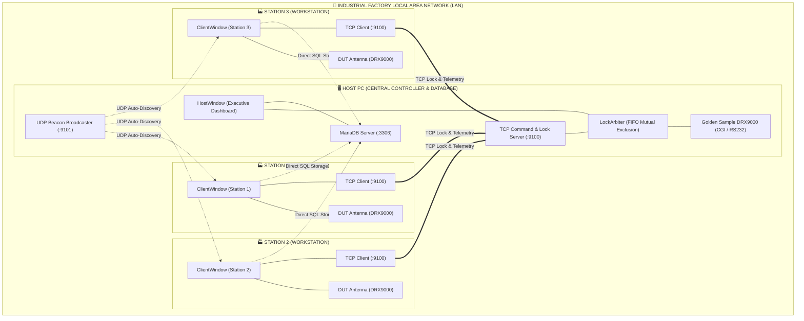
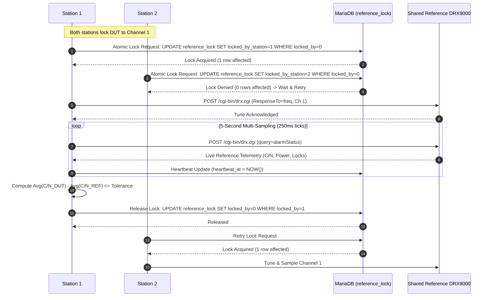
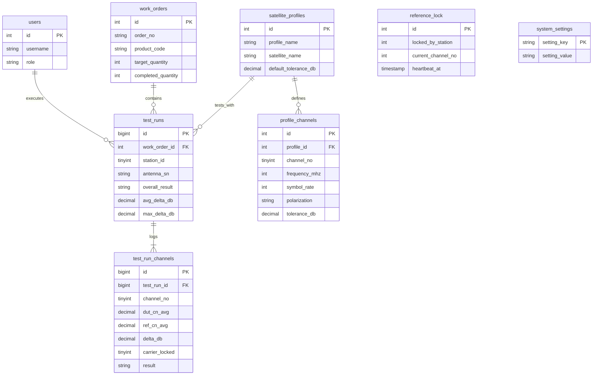

# 🛰️ NETA DRX9000 Multi-Station Antenna Test Automation System

<div align="center">


<p align="center">
  <b>Industrial-Grade Distributed RF Telemetry Benchmarking, Multi-Station Carrier Synchronization, and Automated Quality Assurance for NETA DRX9000 Mobile Satellite Antenna Production Lines</b>
</p>

</div>

---

## 📌 1. Executive Summary

**NETA DRX9000 ANTENNA TEST AUTOMATION** is a distributed, high-precision industrial testing and quality verification system engineered specifically for the factory assembly and quality control lines of **NETA Elektronik A.Ş.**

The application performs fully automated, multi-frequency RF validation of newly assembled **DUT (Device Under Test)** mobile satellite antennas by comparing their live signal characteristics against a factory-calibrated **Golden Sample Reference Antenna**. Measurements encompass 10 predefined satellite transponders (frequencies, symbol rates, and polarizations), collecting and averaging multiple RF telemetry samples per second to compute accurate delta ($\Delta C/N$) metrics and determine instant **PASS / FAIL / WARNING** verdicts.

---

## 🏗️ 2. Dual-Architecture System Design

The system supports two industrial deployment architectures switchable at compile time via [`src/core/build_config.h`](file:///d:/A_SCIENCES/PROJECTS/NETA/DRX-Antenna-Test/src/core/build_config.h):

### Architecture 1: 4-PC Central Host & TCP Mutual Exclusion Arbiter (`NETA_ALGORITMA_1_FOUR_PC`)
- **Host PC (Management Server):** Connects to the Golden Sample Reference DRX9000, hosts the centralized MariaDB database, broadcasts UDP LAN discovery beacons (:9101), and operates a FIFO TCP mutual exclusion lock server (:9100).
- **Stations 1, 2, 3 (Clients):** Each station independently drives its DUT antenna, automatically discovers the Host IP via UDP broadcast, requests reference telemetry over TCP, and records test results to MariaDB.



---

### Architecture 2: 3-PC Distributed MariaDB Lock Queue (`NETA_ALGORITMA_2_THREE_PC`)
- **No Dedicated Host Computer:** Stations 1, 2, and 3 operate as peer workstations.
- **Atomic Database Distributed Lock:** Stations coordinate access to the shared Reference DRX9000 via atomic SQL transactions on the `reference_lock` table.
- **Shared Reference DRX via Web CGI:** The Golden Sample DRX9000 is directly accessible on the LAN (`192.168.0.100`), tuned and interrogated via HTTP Web CGI.
- **Deadlock Protection:** Heartbeat mechanism with 10-second automatic lease expiration prevents stale locks if a station crashes.



---

## 🌐 3. DRX9000 Web CGI / REST API Protocol Standard

Communication with DRX9000 satellite receivers is conducted over industrial CAT6 Ethernet using the embedded HTTP CGI server (`/cgi-bin/drx.cgi`):

| Operation | HTTP Method | CGI Post Data Format | Response Format |
|---|---|---|---|
| **Session Login** | `POST /cgi-bin/drx.cgi` | `ResponseTo=login\nsessionKey=\nlg_username=admin\nlg_password=1234\n` | JSON: `{"sessionkey": 30098, "menuheader": "Session Key"}` |
| **Transponder Tune** | `POST /cgi-bin/drx.cgi` | `ResponseTo=freq\nsessionKey=XXXX\nfr_frequency=12207000\nfr_srate=27500000\nfr_pol=0\n` | JSON: `{"menuheader": "Frekans", "elements": [...]}` |
| **Live Telemetry Query** | `POST /cgi-bin/drx.cgi` | `query=alarmStatus\nsessionKey=XXXX\n` | Multi-section JSON containing RF parameters |
| **Device Identification** | `POST /cgi-bin/drx.cgi` | `query=deviceInfo\nsessionKey=XXXX\n` | JSON with SW version, MAC, and Tuner model |

### Robust Telemetry Parser Engine
The driver ([`src/hardware/drx_web_client.cpp`](file:///d:/A_SCIENCES/PROJECTS/NETA/DRX-Antenna-Test/src/hardware/drx_web_client.cpp)) incorporates specialized regex filtering and format normalization:
- **Spaced Negative RF Power:** Sanitizes inputs like `"- 39 dBm"` into `-39.0 dBm` (avoiding false positive conversion to `+39 dBm`).
- **Scientific Notation Support:** Correctly parses Bit Error Rate (`"1.0E-7"` $\rightarrow 1.0 \times 10^{-7}$).
- **Unit Decoupling:** Strips `dB`, `dBm`, and localized decimal separators (`,`).
- **Multi-State Carrier Locking:** Evaluates `"tick"` tokens for Carrier (`st_signal`), Video (`st_video`), and Audio (`st_audio`).

---

## ⏱️ 4. Test Execution Lifecycle (18-Step Pipeline)

Each production run executes an 18-step sequential test flow ensuring consistent, repeatable measurements:

```
[1. Barcode Scan]  ──>  [2. Database Lookup]  ──>  [3. DUT Init]
                                                          │
   ┌──────────────────────────────────────────────────────┘
   ▼
[4. Transponder Loop (Ch 1..10)]
   │
   ├─► [5. DUT Frequency Tuning]  ──►  [6. DUT Carrier Lock Check (Timeout 15s)]
   │                                                 │
   │   ┌─────────────────────────────────────────────┘
   │   ▼
   ├─► [7. Reference Lock Acquisition] (TCP Arbiter / MariaDB Atomic Mutex)
   │
   ├─► [8. Reference DRX Tuning & Lock Check]
   │
   ├─► [9. Simultaneous Multi-Sampling] (5 seconds @ 250ms ticks = 20 samples)
   │      - Samples: DUT C/N, DUT Power, REF C/N, REF Power, BER, Eb/N0
   │
   ├─► [10. Release Reference Lock] (Immediate release for awaiting stations)
   │
   ├─► [11. Average Calculation & Delta Evaluation]
   │      - Delta = DUT_Avg_CN - REF_Avg_CN
   │      - PASS: Delta <= Channel_Tolerance_dB AND Carrier/Video Locked
   │
   └─► (Repeat for remaining transponders)
         │
         ▼
[12. Overall Evaluation]  ──►  [13. MariaDB Commit]  ──►  [14. Barcode Label Print]
```

---

## 🗄️ 5. Database Schema & Architecture

The centralized MariaDB database ([`sql/schema_mysql.sql`](file:///d:/A_SCIENCES/PROJECTS/NETA/DRX-Antenna-Test/sql/schema_mysql.sql)) contains 8 dedicated tables:



---

## 🛠️ 6. Developer & Debug Test Runner Console

When `#define NETA_DEBUG_MODE` is active in `src/core/build_config.h`, the application directly launches the **Interactive Debug Runner Console** ([`src/ui/debug/debug_runner_window.h`](file:///d:/A_SCIENCES/PROJECTS/NETA/DRX-Antenna-Test/src/ui/debug/debug_runner_window.h)):

- **CGI Authentication & Keep-Alive:** Dynamic `sessionKey` acquisition and validation.
- **Manual Frequency Jumping:** Direct testing of RF tuning commands (Frequency, Symbol Rate, Polarity).
- **Multi-Sample Averaging Simulator:** Configurable 1–30s sampling duration with live dials for C/N, Power, Eb/N0, and BER.
- **Raw JSON Telemetry Inspector:** Pretty-printed, indented JSON responses with a one-click clipboard copy tool.
- **Full Device Page Scanner:** Automated batch querying of `alarmStatus`, `channeldetails`, `frequency`, and `deviceInfo`.

---

## 💻 7. Building and Packaging

### Prerequisites
- **Operating System:** Windows 10 or 11 (32-bit / 64-bit)
- **Framework & Compiler:** Qt 5.15.0 with MinGW 8.1.0 32-bit (`C:\Software\Qt\5.15.0\mingw81_32`)
- **Installer Builder:** Inno Setup 7 (`C:\Software\Inno Setup 7\ISCC.exe`)
- **Documentation Engine:** Doxygen 1.9+ & Graphviz (`doxygen Doxyfile`)

### Build Scripts
- **Compile Clean Release Package:**
  ```cmd
  build.bat
  ```
  *Cleans temporary directories, compiles with `qmake` and `mingw32-make`, resolves all Qt dependencies via `windeployqt`, copies MySQL drivers, and prepares a standalone `OUTPUT/` distribution.*

- **Build Single-Click Inno Setup Installer:**
  ```cmd
  setup.bat
  ```
  *Invokes `build.bat` and compiles a professional self-extracting installer executable in `SETUP_OUTPUT/`.*

- **Semantic Version Bump:**
  ```cmd
  set_version.bat patch   :: 1.0.0 -> 1.0.1
  set_version.bat minor   :: 1.0.0 -> 1.1.0
  set_version.bat major   :: 1.0.0 -> 2.0.0
  ```
  *Synchronizes `project.ini` with `appinfo.h`, `NETA_Antenna_Test.pro`, and `neta_setup.iss`.*

- **Generate Doxygen HTML API Documentation:**
  ```cmd
  generate_docs.bat
  ```

---

## 📁 8. Repository Structure

```
DRX-Antenna-Test/
├── project.ini                      # Single source of truth for version and metadata
├── build.bat                        # Automated clean compilation and deployment packaging
├── setup.bat                        # One-click Inno Setup 7 installer generation
├── set_version.bat                  # Semantic version updater
├── sync_version.ps1                 # Configuration synchronizer engine
├── NETA_Antenna_Test.pro            # Qt qmake project definition
├── Doxyfile                         # Doxygen API documentation configuration
├── LICENSE                          # Proprietary enterprise license agreement
├── resources.qrc                    # Application resources (icons, logos, schemas)
│
├── docs/                            # High-resolution architectural flowcharts
│   ├── DRX ANTENNA ALGORITMA 1 AKIS SEMASI.png
│   ├── DRX ANTENNA ALGORITMA 2 AKIS SEMASI.png
│   ├── DRX ANTENNA SISTEM MIAMRISI ALGORITMA 1.png
│   └── DRX ANTENNA SISTEM MIMARISI ALGORITMA 2.png
│
├── sql/                             # Database initialization scripts
│   ├── schema_mysql.sql             # MariaDB production schema
│   └── seed_data.sql                # Default satellite profiles and transponder channels
│
├── src/                             # C++17 Application Source Code
│   ├── main.cpp                     # Application entry point & command line parser
│   ├── core/                        # System configuration, arbitration, and state machine
│   │   ├── appinfo.h                # Auto-generated application metadata
│   │   ├── app_config.h/.cpp        # Persistent INI settings manager
│   │   ├── build_config.h           # Architecture & debug mode macro toggles
│   │   ├── data_models.h            # Telemetry, profile, and test run structs
│   │   ├── dependency_installer.h   # Automated MariaDB installation engine
│   │   ├── lock_arbiter.h/.cpp      # FIFO mutual exclusion arbiter (Algoritma 1)
│   │   ├── test_state_machine.h     # 18-step antenna test execution coordinator
│   │   └── xlsxutil.h/.cpp          # Official Excel (.xlsx) quality report exporter
│   ├── database/                    # Database interface
│   │   └── db_manager.h/.cpp        # MariaDB connection pool, queries & atomic lock
│   ├── hardware/                    # Device drivers & communication protocols
│   │   ├── drx_web_client.h/.cpp    # High-performance HTTP Web CGI client
│   │   ├── serial_worker.h/.cpp     # RS232 serial telemetry worker (fallback)
│   │   └── protocolhandler.h/.cpp   # Binary frame parser
│   ├── network/                     # Network communication layer
│   │   ├── tcp_server.h/.cpp        # Lock & telemetry command server
│   │   ├── tcp_client.h/.cpp        # Station TCP client
│   │   └── udp_beacon.h/.cpp        # Zero-config LAN discovery broadcaster
│   └── ui/                          # Qt Widget User Interface Layer
│       ├── client/                  # Station operator interface (ClientWindow, ChannelCards)
│       ├── host/                    # Central management dashboard (HostWindow)
│       ├── common/                  # Style helper, custom dialogs, QCustomPlot
│       └── debug/                   # Standalone developer test console (DebugRunnerWindow)
│
└── tools/                           # Deployment & installer utilities
    ├── deploy/                      # Release packaging scripts
    ├── installer/                   # Inno Setup 7 configuration (neta_setup.iss)
    ├── setup_mysql/                 # MariaDB automated silent installer
    └── sqldrivers/                  # Precompiled 32-bit MinGW QMYSQL drivers (libmysql.dll)
```

---

## 👨‍💻 9. Author and Corporate Attribution

This automation system was conceived, designed, and developed by **Semi Eren Gökyıldız** for **NETA ELEKTRONİK A.Ş.** to achieve automated quality control, comparative RF telemetry benchmarking, and real-time distributed synchronization on factory production lines.

- **Primary Developer & Architect:** Semi Eren Gökyıldız
- **Corporate Entity:** [NETA ELEKTRONİK A.Ş.](https://www.neta.com.tr)
- **Copyright:** Copyright © 2026 NETA Elektronik A.Ş. All rights reserved.
- **License:** Refer to the [`LICENSE`](file:///d:/A_SCIENCES/PROJECTS/NETA/DRX-Antenna-Test/LICENSE) file for terms and conditions.
