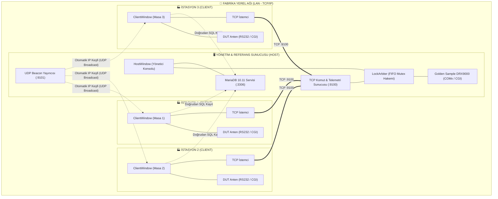

# 🛰️ NETA DRX9000 Çoklu İstasyonlu Anten Test Otomasyonu

<div align="center">


-0078D6?style=for-the-badge&logo=windows&logoColor=white)


<p align="center">
  <b>NETA Elektronik A.Ş. Seri Üretim Bandı İçin Geliştirilmiş Dağıtık RF Test, Referans Karşılaştırma ve Kalite Takip Sistemi</b>
</p>

</div>

---

## 📌 Genel Bakış

**NETA DRX9000 ANTENNA TEST AUTOMATION**, NETA DRX9000 serisi mobil uydu anten sistemlerinin fabrika ortamında eşzamanlı, yüksek doğruluklu ve tam otomatik olarak test edilmesini sağlayan endüstriyel bir otomasyon yazılımıdır. 

Sistem, üretim hattındaki **3 bağımsız test masasını (Client)** tek bir **Merkezi Yönetim ve Referans Sunucusuna (Host)** yerel ağ (LAN) üzerinden bağlar. Masalar, merkezi sunucuya bağlı sabit referans anten (*Golden Sample*) ile test edilen antenin (*DUT*) RF sinyal seviyelerini (C/N, Güç, BER, Eb/N0) 10 farklı Türksat transponder frekansında eşzamanlı kıyaslayarak milisaniyeler mertebesinde Pass/Fail kararı verir.

---

## 🏗️ Sistem Mimarisi



---

## ✨ Temel Özellikler

- **Tek İkili (All-in-One Binary) Mimarisi:** Aynı `.exe` dosyası hem Yönetim Sunucusu (Host) hem de Test Masası (Client) olarak çalışabilir. İlk açılışta modern rol seçim ekranı açılır veya `--host` / `--client -s <ID>` parametreleriyle doğrudan başlar.
- **Sıfır Ağ Yapılandırması (Zero-Config UDP Discovery):** Yönetici PC başladığında yerel ağa UDP Beacon yayını yapar; test masaları sunucu IP adresini manuel ayara gerek kalmadan otomatik keşfeder.
- **Donanımsal Kilit Hakemi (Distributed Mutex Arbiter):** Ortak kullanılan referans alıcısı için FIFO tabanlı donanım kilidi yönetimi. Çakışmaları ve hatalı ölçümleri %100 engeller, zaman aşımı koruması içerir.
- **10 Kanal Otomatik RF Analizi:** 10 transponder frekansını sırayla tarar; taşıyıcı kilidi (Carrier Lock), video/ses kilitleri denetlenir ve referans antenle $\Delta$ fark hesabı yapılır.
- **Otomatik MariaDB/MySQL Entegrasyonu:** Sunucu ilk açılışta veritabanı servisini ve portlarını kontrol eder, eksikse tek tıkla sessiz kurulumunu yapar ve fabrika test şemasını başlatır.
- **Resmi Excel (XLSX) Kalite Raporlama:** Host ekranından tek tıkla iş emirleri, test geçmişi ve tolerans analizleri profesyonel Excel formatında dışa aktarılır.

---

## 📁 Proje Dosya ve Dizin Hiyerarşisi

```
DRX-Antenna-Test/
├── project.ini                      # Merkezi yapılandırma ve sürüm yönetim dosyası
├── build.bat                        # Tek tıkla Release derleme ve OUTPUT paketleme
├── setup.bat                        # Inno Setup 7 ile tek parça Installer üretimi
├── set_version.bat                  # Semantik sürüm artırıcı (patch / minor / major)
├── sync_version.ps1                 # project.ini senkronizasyon motoru
├── NETA_Antenna_Test.pro            # Qt Proje dosyası
├── resources.qrc                    # Dahili logo, ikon ve SQL şemaları
├── LICENSE                          # Kurumsal telif hakkı ve lisans sözleşmesi
│
├── docs/                            # Detaylı sistem mimarisi dokümantasyonu
│   ├── SISTEM_MIMARISI.md
│   └── İş Akış Şeması.png
│
├── resources/                       # Görsel kaynaklar
│   └── images/                      # logo.png, neta_app.ico, neta_app.png
│
├── sql/                             # Veritabanı şeması ve test profilleri seed verisi
│   ├── schema_mysql.sql
│   └── seed_data.sql
│
├── src/                             # C++17 Kaynak Kodları
│   ├── main.cpp                     # Giriş noktası ve CLI parametre işleyici
│   ├── core/                        # AppConfig, appinfo.h, LockArbiter, StateMachine, XlsxUtil, DependencyInstaller
│   ├── database/                    # DbManager (MariaDB bağlantısı ve modeller)
│   ├── hardware/                    # DataTransfer (Base), Ethernet (Web CGI) ve RS232 (Seri Port) sürücüleri
│   ├── network/                     # TcpServer, TcpClient, UdpBeacon
│   └── ui/                          # Grafik Arayüz Katmanı
│       ├── common/                  # LobbyWindow, LoginDialog, TestHistoryWidget (SQL Tarayıcı ile), ProfileManager, StyleHelper
│       ├── client/                  # ClientWindow, ChannelCardWidget
│       ├── host/                    # HostWindow, GoldenReferenceWidget, UserManagerWidget
│       └── debug/                   # DebugRunnerWindow (F12 Geliştirici & Test Konsolu)
│
└── tools/                           # Dağıtım ve kurulum araçları
    ├── deploy/                      # Windeployqt ve otomatik paketleme scriptleri
    ├── installer/                   # Inno Setup 7 scripti (neta_setup.iss)
    ├── mariadb_portable/            # Taşınabilir MariaDB 10.11 sıfır-kurulum motoru
    └── sqldrivers/                  # Hazır 32-bit QMYSQL sürücüleri (libmysql.dll)
```

---

## ⚙️ Merkezi Yapılandırma (`project.ini`)

Tüm proje başlıkları, sürüm numaraları ve şirket bilgileri kök dizindeki [`project.ini`](file:///d:/A_SCIENCES/PROJECTS/NETA/DRX-Antenna-Test/project.ini) dosyasından yönetilir:

```ini
[PROJECT]
AppName=NETA DRX9000 ANTENNA TEST AUTOMATION
AppTitle=NETA DRX9000 ANTENNA TEST
Version=1.0.0
Developer=Semi Eren Gökyıldız
Company=NETA Elektronik A.S.
Website=https://www.neta.com.tr
Domain=neta.com.tr
Copyright=Copyright (C) 2026 NETA Elektronik A.S.
TargetExe=NETA_Antenna_Test
InstallerPrefix=NETA_DRX9000_ANTENNA_Test_Setup
```

`build.bat` veya `setup.bat` çalıştırıldığında bu değerler kaynak kodlara (`appinfo.h`), Qt proje dosyasına (`.pro`) ve kurulum scriptine (`.iss`) otomatik olarak senkronize edilir.

---

## 🚀 Derleme ve Kurulum

### Gereksinimler
- **İşletim Sistemi:** Windows 10 / 11 (64-bit veya 32-bit)
- **Derleyici & Çerçeve:** Qt 5.15.0 (MinGW 8.1.0 32-bit)
- **Kurulum Motoru:** Inno Setup 7 (`C:\Software\Inno Setup 7\ISCC.exe`)

### Hızlı Komutlar
- **Release Derleme:**
  ```cmd
  build.bat
  ```
  *Eski `build/` ve `temp_build/` dizinlerini temizler, projeyi sıfırdan derler ve `OUTPUT/` dizinine taşınabilir hazır paket üretir.*

- **Tek Tıkla Setup Üretimi:**
  ```cmd
  setup.bat
  ```
  *Sıfırdan derleme yapar ve `SETUP_OUTPUT/` klasörüne `NETA_DRX9000_ANTENNA_Test_Setup_vX.Y.Z.exe` tek parça kurulum dosyasını oluşturur.*

- **Sürüm Artırma:**
  ```cmd
  set_version.bat patch   :: 1.0.0 -> 1.0.1
  set_version.bat minor   :: 1.0.0 -> 1.1.0
  set_version.bat major   :: 1.0.0 -> 2.0.0
  ```

---

## 📸 Sistem Ekran Görüntüleri ve Mimari Şemalar

### Mimari ve Akış Şemaları
- **Algoritma 1 Akış Şeması:** [`docs/DRX_Algorithm_1_Flowchart.png`](file:///d:/A_SCIENCES/PROJECTS/NETA/DRX-Antenna-Test/docs/DRX_Algorithm_1_Flowchart.png)
- **Algoritma 2 Akış Şeması:** [`docs/DRX_Algorithm_2_Flowchart.png`](file:///d:/A_SCIENCES/PROJECTS/NETA/DRX-Antenna-Test/docs/DRX_Algorithm_2_Flowchart.png)
- **Algoritma 1 Sistem Mimarisi:** [`docs/DRX_System_Architecture_Algorithm_1.png`](file:///d:/A_SCIENCES/PROJECTS/NETA/DRX-Antenna-Test/docs/DRX_System_Architecture_Algorithm_1.png)
- **Algoritma 2 Sistem Mimarisi:** [`docs/DRX_System_Architecture_Algorithm_2.png`](file:///d:/A_SCIENCES/PROJECTS/NETA/DRX-Antenna-Test/docs/DRX_System_Architecture_Algorithm_2.png)

### Uygulama Arayüzleri (`docs/screenshots/`)
1. **Kullanıcı Giriş Ekranı:** [`docs/screenshots/01_User_Login_Screen.png`](file:///d:/A_SCIENCES/PROJECTS/NETA/DRX-Antenna-Test/docs/screenshots/01_User_Login_Screen.png)
2. **Ağ Lobisi Sunucu Seçimi:** [`docs/screenshots/02_Network_Lobby_Server_Select.png`](file:///d:/A_SCIENCES/PROJECTS/NETA/DRX-Antenna-Test/docs/screenshots/02_Network_Lobby_Server_Select.png)
3. **İstasyon Üretim Testi (Hazır):** [`docs/screenshots/03_Station_Production_Test_Idle.png`](file:///d:/A_SCIENCES/PROJECTS/NETA/DRX-Antenna-Test/docs/screenshots/03_Station_Production_Test_Idle.png)
4. **İstasyon Üretim Testi (Çalışıyor):** [`docs/screenshots/04_Station_Production_Test_Running.png`](file:///d:/A_SCIENCES/PROJECTS/NETA/DRX-Antenna-Test/docs/screenshots/04_Station_Production_Test_Running.png)
5. **İstasyon Test Matrisi Canlı Sonuçlar:** [`docs/screenshots/05_Station_Test_Matrix_Results.png`](file:///d:/A_SCIENCES/PROJECTS/NETA/DRX-Antenna-Test/docs/screenshots/05_Station_Test_Matrix_Results.png)
6. **İstasyon Test Tamamlandı (FAIL):** [`docs/screenshots/06_Station_Test_Finished_Fail.png`](file:///d:/A_SCIENCES/PROJECTS/NETA/DRX-Antenna-Test/docs/screenshots/06_Station_Test_Finished_Fail.png)
7. **Uydu Profilleri Yönetimi:** [`docs/screenshots/07_Satellite_Profiles_Management.png`](file:///d:/A_SCIENCES/PROJECTS/NETA/DRX-Antenna-Test/docs/screenshots/07_Satellite_Profiles_Management.png)
8. **Mühendis Parametre ve Ayarları:** [`docs/screenshots/08_Engineer_Settings_Parameters.png`](file:///d:/A_SCIENCES/PROJECTS/NETA/DRX-Antenna-Test/docs/screenshots/08_Engineer_Settings_Parameters.png)
9. **Host Canlı Test Lobisi ve Mutex:** [`docs/screenshots/09_Host_Live_Test_Lobby_Mutex.png`](file:///d:/A_SCIENCES/PROJECTS/NETA/DRX-Antenna-Test/docs/screenshots/09_Host_Live_Test_Lobby_Mutex.png)
10. **Host Ağdaki PC'ler ve Durumlar:** [`docs/screenshots/10_Host_Network_Station_Status.png`](file:///d:/A_SCIENCES/PROJECTS/NETA/DRX-Antenna-Test/docs/screenshots/10_Host_Network_Station_Status.png)
11. **Host Sistem ve Donanım Ayarları:** [`docs/screenshots/11_Host_System_Settings.png`](file:///d:/A_SCIENCES/PROJECTS/NETA/DRX-Antenna-Test/docs/screenshots/11_Host_System_Settings.png)
12. **Host Sistem ve Ağ Logları:** [`docs/screenshots/12_Host_System_Logs.png`](file:///d:/A_SCIENCES/PROJECTS/NETA/DRX-Antenna-Test/docs/screenshots/12_Host_System_Logs.png)
13. **Host Kullanıcı ve Yetkilendirme:** [`docs/screenshots/13_Host_User_Authorization_Management.png`](file:///d:/A_SCIENCES/PROJECTS/NETA/DRX-Antenna-Test/docs/screenshots/13_Host_User_Authorization_Management.png)
14. **Yönetici Sunucu Kapatıldı Uyarısı:** [`docs/screenshots/14_Server_Shutdown_Warning.png`](file:///d:/A_SCIENCES/PROJECTS/NETA/DRX-Antenna-Test/docs/screenshots/14_Server_Shutdown_Warning.png)

---

## 👨‍💻 Geliştirici ve İthaf

Bu otomasyon yazılımı; NETA DRX9000 serisi mobil uydu anten sistemlerinin seri üretim hattında çoklu istasyon eşzamanlı test, referans almaç karşılaştırmalı canlı RF telemetri analizi, otomatik taşıyıcı/video kilitleme denetimi ve fabrika merkezi veritabanı kalite kayıt süreçleri amacıyla **Semi Eren Gökyıldız** tarafından özel olarak tasarlanıp geliştirilmiştir.

- **Geliştirici:** Semi Eren Gökyıldız
- **Kurumsal:** [NETA ELEKTRONİK A.Ş.](https://www.neta.com.tr)
- **Telif Hakkı:** Copyright © 2026 NETA Elektronik A.Ş. Tüm hakları saklıdır.
- **Lisans:** Ayrıntılar için [`LICENSE`](file:///d:/A_SCIENCES/PROJECTS/NETA/DRX-Antenna-Test/LICENSE) dosyasına bakınız.
