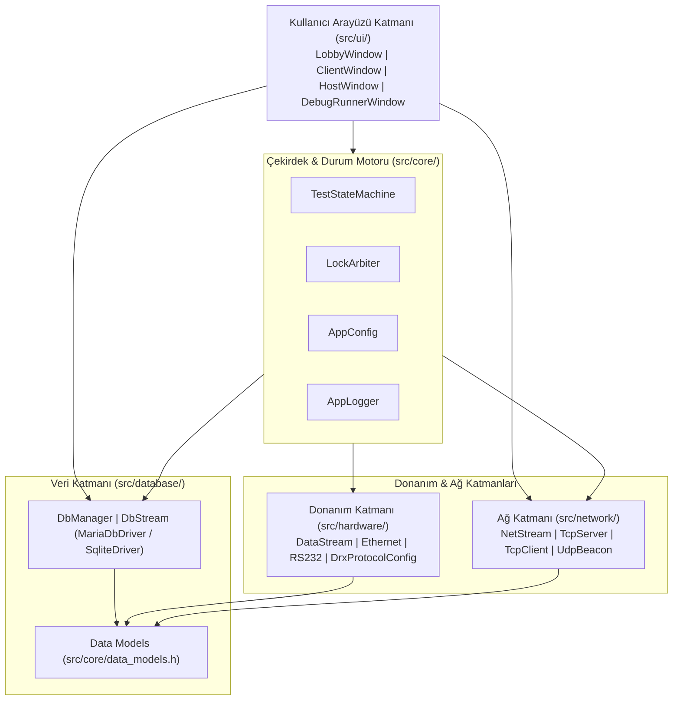
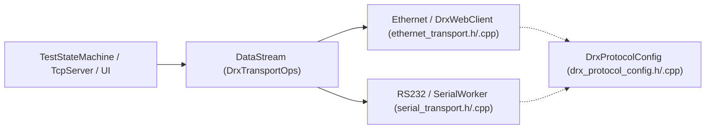

# 🛰️ NETA DRX9000 - Detaylı Kod Mimarisi ve API Rehberi

Bu belge, **NETA DRX9000 ANTENNA TEST AUTOMATION** sisteminin tüm kaynak kod tabanını, katmanlı yazılım mimarisini, C++ sınıflarını, veri modellerini, donanım haberleşme protokollerini, ağ topolojisini ve kullanıcı arayüzü bileşenlerini Doxygen standartları temelinde ayrıntılı olarak açıklamaktadır.

---

## 📑 İçindekiler
1. [Genel Mimari ve Katman Hiyerarşisi](#1-genel-mimari-ve-katman-hiyerarşisi)
2. [Çekirdek Katmanı (`src/core/`)](#2-çekirdek-katmanı-srccore)
   - [appinfo.h & build_config.h](#appinfoh--build_configh)
   - [data_models.h](#data_modelsh)
   - [AppConfig (app_config.h / .cpp)](#appconfig)
   - [AppLogger (app_logger.h / .cpp)](#applogger)
   - [LockArbiter (lock_arbiter.h / .cpp)](#lockarbiter)
   - [TestStateMachine (test_state_machine.h / .cpp)](#teststatemachine)
   - [DependencyInstaller (dependency_installer.h / .cpp)](#dependencyinstaller)
   - [XlsxUtil (xlsxutil.h / .cpp)](#xlsxutil)
   - [PdfReportGenerator (pdf_report_generator.h / .cpp)](#pdfreportgenerator)
   - [SpcCalculator (spc_calculator.h / .cpp)](#spccalculator)
3. [Veritabanı Katmanı (`src/database/`)](#3-veritabanı-katmanı-srcdatabase)
   - [DbManager (db_manager.h / .cpp)](#dbmanager)
4. [Donanım ve Haberleşme Katmanı (`src/hardware/`)](#4-donanım-ve-haberleşme-katmanı-srchardware)
   - [DataTransfer (Soyut Taban Sınıf)](#datatransfer-soyut-taban-sınıf)
   - [EthernetTransfer (Web CGI / HTTP Taşıyıcı)](#ethernettransfer-web-cgi--http-taşıyıcı)
   - [RS232Transfer (Seri Port / COM Taşıyıcı)](#rs232transfer-seri-port--com-taşıyıcı)
5. [Ağ ve Dağıtık İletişim Katmanı (`src/network/`)](#5-ağ-ve-dağıtık-iletişim-katmanı-srcnetwork)
   - [network_messages.h](#network_messagesh)
   - [UdpBeacon (udp_beacon.h / .cpp)](#udpbeacon)
   - [TcpServer (tcp_server.h / .cpp)](#tcpserver)
   - [TcpClient (tcp_client.h / .cpp)](#tcpclient)
6. [Kullanıcı Arayüzü Katmanı (`src/ui/`)](#6-kullanıcı-arayüzü-katmanı-srcui)
   - [Ortak Bileşenler (`src/ui/common/`)](#ortak-bileşenler-srcuicommon)
     - [LobbyWindow](#lobbywindow)
     - [LoginDialog & AboutDialog](#logindialog--aboutdialog)
     - [TestHistoryWidget (Geçmiş + SQL Tablo Tarayıcısı)](#testhistorywidget)
     - [ProfileManagerWidget](#profilemanagerwidget)
     - [StyleHelper & QCustomPlot](#stylehelper--qcustomplot)
   - [İstemci / Test İstasyonu Arayüzü (`src/ui/client/`)](#istemci--test-istasyonu-arayüzü-srcuiclient)
     - [ClientWindow](#clientwindow)
     - [ChannelCardWidget](#channelcardwidget)
   - [Sunucu / Yönetici Arayüzü (`src/ui/host/`)](#sunucu--yönetici-arayüzü-srcuihost)
     - [HostWindow](#hostwindow)
     - [GoldenReferenceWidget](#goldenreferencewidget)
     - [UserManagerWidget](#usermanagerwidget)
   - [Geliştirici ve Teşhis Konsolu (`src/ui/debug/`)](#geliştirici-ve-teşhis-konsolu-srcuidebug)
     - [DebugRunnerWindow (F12 Konsolu)](#debugrunnerwindow-f12-konsolu)
7. [Çoklu Algoritma Yönetimi (4 PC vs 3 PC)](#7-çoklu-algoritma-yönetimi-4-pc-vs-3-pc)
8. [Doxygen ile Dokümantasyon Üretimi](#8-doxygen-ile-dokümantasyon-üretimi)

---

## 1. Genel Mimari ve Katman Hiyerarşisi

Sistem, **Model-View-Controller (MVC)** ve **Katmanlı Servis Mimarisi (Layered Architecture)** prensiplerine göre yapılandırılmıştır.



---

## 2. Çekirdek Katmanı (`src/core/`)

### `appinfo.h` & `build_config.h`
- **`appinfo.h`**: Uygulamanın adı, sürümü (`NETA_APP_VERSION`), geliştirici (`Semi Eren Gökyıldız`), telif hakkı ve kurumsal kimlik metaverilerini barındırır. Kök dizindeki `project.ini` ve `sync_version.ps1` tarafından otomatik senkronize edilir.
- **`build_config.h`**: Projenin çalışma mimarisini seçen merkezi makro dosyasını oluşturur:
  - `#define NETA_ALGORITMA_1_FOUR_PC`: 1 Host Sunucu + 3 Test İstasyonu, TCP Mutex Hakemi.
  - `#define NETA_ALGORITMA_2_THREE_PC`: Dağıtık 3 İstasyon, MariaDB atomik satır kilitleme kuyruğu.

### `data_models.h`
Tüm sistemde paylaşılan ana veri yapılarını ve JSON serileştirme fonksiyonlarını içerir:
- **`TransponderConfig`**: Bir uydu kanalının frekansı (`frequencyMhz`), sembol oranı (`symbolRate`), polarizasyonu (`polarization`), LNB tipi ve hedef referans değerlerini tanımlar.
- **`ChannelSampleResult`**: Test edilen kanalda ölçülen DUT C/N, DUT Güç, Referans C/N, Referans Güç, Delta ($\Delta$), kilit durumları (`carrierLocked`, `videoLocked`, `audioLocked`) ve tolerans değerlendirmesini tutar.
- **`TestRunData`**: Test edilen bir antenin seri numarası (`antennaSn`), iş emri (`workOrderId`), istasyon ID (`stationId`), operatör bilgisi, başlangıç zamanı (`timestamp`), ortalama/maksimum delta ve tüm kanal sonuçlarını (`channels`) içeren ana kayıt yapısıdır.
- **`WorkOrderInfo`**: Fabrika iş emri numarası, hedef miktar, üretilen miktar, Pass/Fail sayaçları.
- **`SatelliteProfileInfo`**: Uydu yörünge pozisyonu ve 10 adet transponder yapılandırması.
- **`GoldenFrequencyRecord`**: Host bağımsız Golden Sample havuzundaki frekans referans kayıtları.
- **`UserRecord`**: Kullanıcı hesapları ve yetki seviyeleri (`Operator`, `Technician`, `Engineer`).

### `AppConfig` (`app_config.h` / `app_config.cpp`)
- **Tasarım Deseni:** Singleton (`AppConfig::instance()`).
- **Görevi:** INI dosyası (`neta_config.ini`) üzerinden IP adresleri, portlar, COM portları, baudrate ayarları, tolerans limitleri, zaman aşımı süreleri ve istasyon ID'lerini yönetir.
- **Önemli Metotlar:**
  - `loadConfig()` / `saveConfig()`: Yapılandırma dosyasını okur/yazar.
  - `launchSimulator()`: DRX simülatörünü arka planda başlatır.
  - `isSimulatorRunning()`: Simülatör sürecinin durumunu kontrol eder.

### `AppLogger` (`app_logger.h` / `app_logger.cpp`)
- **Tasarım Deseni:** Singleton.
- **Görevi:** Konsol çıktısı, dosya loglama (`logs/neta_app_YYYYMMDD.log`) ve Qt'nin `qInstallMessageHandler` kancası ile `qDebug()`, `qInfo()`, `qWarning()`, `qCritical()` mesajlarını toplar.
- **Sinyaller:**
  - `logGenerated(const QString &formattedMessage)`: Logları arayüzdeki konsol pencerelerine yönlendirir.

### `LockArbiter` (`lock_arbiter.h` / `lock_arbiter.cpp`)
- **Tasarım Deseni:** FIFO Kuyruklu Mutex Hakemi (Host üzerinde çalışır).
- **Görevi:** Ortak kullanılan tek referans almaç (Golden Sample) cihazına aynı anda yalnızca bir test istasyonunun erişmesini garanti eder. İstasyonlar kilit talep ettiğinde kuyruğa alınır; kilit boşaldığında sıradakine verilir.
- **Zaman Aşımı Güvenliği:** Bir istasyon kilidi alıp 15 saniye içinde serbest bırakmazsa `autoReleaseTimer` devreye girerek kilidi zorla geri alır ve sıradaki istasyona devreder.
- **Önemli Metotlar:**
  - `requestLock(int stationId, const QString &reqId)`: Kilit kuyruğuna ekler.
  - `releaseLock(int stationId, const QString &reqId)`: Kilidi bırakır.
- **Sinyaller:**
  - `lockGranted(int stationId, const QString &reqId)`: Kilit tahsis edildi sinyali.
  - `queueUpdated(const QStringList &queueInfo)`: Arayüz için güncel kuyruk durumu.

### `TestStateMachine` (`test_state_machine.h` / `test_state_machine.cpp`)
- **Görevi:** 10 transponder kanalının ardışık otomatik test sürecini yöneten durum makinesi.
- **Test ve Referans Modları:**
  - **Canlı Test (`ReferenceMode::LiveReference`):** Test masası, fiziksel referans çanak anten (Host PC veya doğrudan Ethernet) ile eşzamanlı çalışır. Donanım kilidi talep edilir. Her kanal için varsayılan dwell süresi (`sampleDurationSec`) uygulanır.
  - **Kayıtlı Test (`ReferenceMode::GoldenSample`):** Operatörün ana ekrandan seçtiği kayıtlı Golden Reference ölçümü baz alınır. Donanımsal anten kilidi gerekmez, test anında başlar:
    - *Canlı Kayıt ise (`durationSec > 0`):* Kanal test süresi kaydın kendi süresi kadar (örn. 15 sn) sürer.
    - *Sabit Kayıt ise (`durationSec == 0`):* Varsayılan test süresi (`sampleDurationSec`) uygulanır ve girilen sabit eşik (C/N, Güç, Tolerans) ile karşılaştırma yapılır.
- **Adımlar:**
  1. `Idle` ➔ Barkod tarama, test modu seçimi ve test başlatma (`startTest()`).
  2. `WaitingForLock` ➔ Canlı test ise kilit talep etme, kayıtlı test ise doğrudan başlatma.
  3. `TuningChannel` ➔ DUT almacı hedef frekansa ayarlama (`sendTune()`).
  4. `WaitingCarrierLock` ➔ Taşıyıcı kilit (S:+) bekleme (6s zaman aşımı).
  5. `SamplingTelemetry` ➔ Telemetri toplama (Kayıtlı canlı süresi veya varsayılan süre boyunca 250ms periyotla).
  6. `EvaluatingChannel` ➔ Kanal Geçti/Kaldı (`PASS/FAIL`) kararı yalnızca basit ortalamaya bakılarak verilmez; **4 katmanlı kararlılık denetimi** uygulanır (`finishCurrentChannel()`):
     - **Aritmetik Ortalama Farkı:** $|\overline{\text{DUT}} - \overline{\text{Ref}}| \le \text{Tolerans}$ (ör. $\pm 1.50\text{ dB}$).
     - **Kümülatif Örneklem Değişimi (`CumStepDelta`):** Aynı frekansın ardışık örnekleri ($i=1 \dots N-1$) arasındaki farkların $0.20\text{ dB}$ gürültü ölü bandı düşüldükten sonraki toplamı $\sum \max(0, |(\text{dut}_i - \text{ref}_i) - (\text{dut}_{i-1} - \text{ref}_{i-1})| - 0.20) \le 2 \times \text{Tolerans}$ olmalıdır.
     - **Anlık Sapma ve Salınım Koruması:** Örnek bazlı mutlak sapma ortalaması (`meanAbsDelta`) ve tepe-tepe salınım (`Swing`) birlikte kontrol edilir.
     - *Gerçek Test Örnekleri (Tolerans $\pm 1.50\text{ dB}$):*
       - **Sağlam Anten (`SER0003` / `SER0006`):** Sinyal sabit veya küçük gürültülüdür (`Delta ≈ -0.03..+0.42 dB`, `CumStepDelta = 0.72..1.31 dB <= 1.50 dB`, `Swing <= 0.30 dB`) ➔ **`PASS`**.
       - **Sinüs / Salınımlı Arızalı Anten (`SER0004`):** Artı ve eksi tepeler ortalamada birbirini götürdüğü için ortalama farkı yanıltıcı biçimde küçük kalır (`TRT SPOR HD: Delta = -0.08 dB`), ancak kümülatif değişim ve salınım çok yüksektir (`CumStepDelta = 21.86 dB`, `Swing = 9.80 dB`) ➔ **`FAIL`** yakalanır.
  7. `ReleasingLock` ➔ Canlı testte kilidi iade etme.
  8. `Completed` / `Aborted` ➔ Sonuçları MariaDB'ye kaydetme (`DbManager::insertTestRun()`) ve raporlama.
- **Sinyaller:**
  - `channelStarted(int chNo, const QString &chName, int freqMhz, const QString &pol)`
  - `channelSampleUpdated(int chNo, double dutCn, double dutPow, double refCn, double refPow, double delta)`
  - `channelCompleted(const ChannelSampleResult &result)`
  - `testFinished(const TestRunData &finalRun)`
  - `stateChanged(TestState newState, const QString &stateName)`

### `DependencyInstaller` (`dependency_installer.h` / `dependency_installer.cpp`)
- **Görevi:** Sistemde MariaDB / MySQL kurulu olup olmadığını veya yerel `tools/mariadb_portable` paketinin bulunup bulunmadığını kontrol eder. Eksik durumlarda arka planda sessizce kurulum veya servis başlatma işlemini icra eder.

### `XlsxUtil` (`xlsxutil.h` / `xlsxutil.cpp`)
- **Görevi:** Sıfır dış bağımlılıkla (harici kütüphane gerektirmeden, yalnızca Qt'nin dahili `QZipWriter` ve `QZipReader` sınıflarını kullanarak) Microsoft Excel `.xlsx` dosyalarını okuma ve yazma motorudur.
- **Metotlar:**
  - `writeXlsxSheet(...)`: Başlıklar ve satır matrisini standart bir `.xlsx` çalışma sayfasına yazar.
  - `readXlsxSheet(...)`: `.xlsx` dosyasındaki hücre verilerini ayrıştırıp satır ve sütunlar halinde döner.

### `PdfReportGenerator` (`pdf_report_generator.h` / `pdf_report_generator.cpp`)
- **Görevi:** Fabrika kabul ve müşteri sevkiyat standartlarına uygun, tek sayfalık A4 formatında vektörel Kalite Kontrol (QC) Test Sertifikası PDF belgelerini üretir.
- **Tasarım & Mimari:**
  - `Qt PrintSupport` ve `QTextDocument` HTML/CSS vektörel render motorunu kullanır; hiçbir harici PDF DLL'ine ihtiyaç duymaz.
  - Kurumsal NETA fabrika anteti, Belge Kodu (`NETA-QC-TR<ID>`), İstasyon No ve onay tarihi.
  - Anten Seri No, Ürün Modeli, İş Emri No, Uydu Profili ve Testi Yapan Operatör tablosu.
  - **Çift Zaman Telemetrisi Bölümü:** Test başlangıç/bitiş sistem saati, DRX donanım saati ve toplam test süresi.
  - **10 Kanal Ölçüm Matrisi:** Her transponder için Frekans, Polarizasyon, Taşıyıcı Kilidi, DUT C/N, REF C/N, Delta sapması ($\Delta$ dB), Tolerans ve PASS/FAIL rozetleri.
  - **Büyük Kalite Mührü (Quality Stamp):** Yeşil onay damgası (`✔ KALİTE ONAYI VERİLDİ - PASS`) veya Kırmızı red damgası (`✖ KALİTE STANDARDI DIŞINDA - FAIL`).
  - **İmza & Onay Bölümü:** Test Eden Teknisyen ve Kalite Güvence / Test Mühendisi imza ve onay kutuları.
- **Entegrasyon Noktaları:**
  - Test İstasyonu (`ClientWindow`): Test tamamlandığı anda `reports/certificates/` klasörüne otomatik üretilir; arayüzdeki "📄 Kalite Sertifikasını Aç (PDF)" butonu aktifleşir.
  - Test Geçmişi (`TestHistoryWidget`): Geçmiş test kayıtları listesinden seçilen herhangi bir satır için "📄 PDF Sertifika Üret" butonuyla anında sertifika oluşturulup açılabilir.

### `SpcCalculator` (`spc_calculator.h` / `spc_calculator.cpp`)
- **Görevi:** Üretim hattında test edilen antenlerin sinyal sapmalarının ($\Delta \text{dB}$) normal dağılımını, histogram frekans dilimlerini, süreç yeterlilik indislerini ($C_p, C_{pk}$) ve kümülatif (birikimli) analiz serilerini ($\text{CDF}\%$, $\mu_k$, $\text{CUSUM } S_k$) hesaplayan istatistik motorudur.
- **Formüller:**
  - Örneklem Ortalaması: $\mu = \frac{1}{N}\sum x_i$
  - Standart Sapma: $\sigma = \sqrt{\frac{1}{N-1}\sum (x_i - \mu)^2}$
  - Süreç Yeteneği: $C_p = \frac{\text{USL} - \text{LSL}}{6\sigma}$
  - Süreç Performansı: $C_{pk} = \min\left(\frac{\text{USL} - \mu}{3\sigma}, \frac{\mu - \text{LSL}}{3\sigma}\right)$
  - Gauss Normal Dağılım Fonksiyonu: $f(x) = \frac{1}{\sigma\sqrt{2\pi}} \exp\left(-\frac{(x - \mu)^2}{2\sigma^2}\right)$
  - Kümülatif Dağılım Fonksiyonu (CDF): $F(x) = \frac{1}{2}\left[1 + \text{erf}\left(\frac{x-\mu}{\sigma\sqrt{2}}\right)\right] \times 100\%$
  - Kümülatif Hareketli Ortalama (CMA): $\mu_k = \frac{1}{k}\sum_{i=1}^k x_i$
  - Kümülatif Sapma Toplamı (CUSUM): $S_k = \sum_{i=1}^k (x_i - \mu_0)$
- **Kalite Seviyeleri:**
  - $C_{pk} \ge 1.33$: Mükemmel (4-Sigma üstü kalite, hata riski < 63 PPM).
  - $1.00 \le C_{pk} < 1.33$: Yeterli (Tolerans sınırları içinde, izlenmeli).
  - $C_{pk} < 1.00$: Yetersiz / Sapma Var (Tolerans dışına taşma ve hatalı üretim riski).

### `SpcAnalysisWidget` (`spc_analysis_widget.h` / `spc_analysis_widget.cpp`)
- **Görevi:** `TestHistoryWidget` içinde 4. sekme olarak çalışan, interaktif İstatistiksel Süreç Kontrolü (SPC) ve Kümülatif Analiz paneli.
- **Bileşenler:**
  - **Üst Grafik (`m_plot`):** `QCustomPlot` tabanlı Delta dB histogram çubukları (`QCPBars`), Gauss Çanı eğrisi, sağ eksende (`yAxis2`) $\%0-\%100$ Kümülatif Dağılım S-Eğrisi (`CDF %`), USL/LSL tolerans sınır çizgileri ve $\mu$ ortalama izleyicisi.
  - **Alt Grafik (`m_cumulativePlot`):** Kronolojik $1 \dots N$ test sırasına göre Tekil Anten $\Delta$ ($x_k$), Kümülatif Hareketli Ortalama ($\mu_k$) ve sağ eksende Kümülatif Sapma Toplamı ($\text{CUSUM } S_k$) sinsi kayma (drift) grafiği.
  - Canlı $C_{pk}$, $\text{CUSUM } S_N$ durum rozeti ve detaylı istatistik parametre kartları.
  - İş emri, istasyon, uydu profili ve örneklem sayısı filtreleme.
  - PNG ve PDF formatında yüksek çözünürlüklü grafik dışa aktarımı.

---

## 3. Veritabanı Katmanı (`src/database/`)

Veritabanı katmanı fiziksel SQL sürücülerinden fonksiyon-işaretçisi tabanlı `DbStream` soyutlamasıyla ayrılmıştır:
- **Fiziksel Sürücüler:** `MariaDbDriver` (`mariadb_driver.h/.cpp` — `QMYSQL`/`QODBC` ve Portable `mysqld` yönetimi) ve `SqliteDriver` (`sqlite_driver.h/.cpp` — `QSQLITE` yerel fallback).
- **Soyutlama Katmanı:** `DbStream` (`db_stream.h/.cpp` — `DbDriverOps`, `DbRow`, `DbQueryResult`). Üst iş mantığı (`DbManager`, `BackupManager`) doğrudan `QSqlDatabase` / `QSqlQuery` bilmez; tüm sorgular `DbStream` üzerinden yürütülür.

### `DbManager` (`db_manager.h` / `db_manager.cpp`)
- **Tasarım Deseni:** Singleton (`DbManager::instance()`) + `setStream(DbStream*)` ile değiştirilebilir arka uç desteği.
- **Görevi:** `DbStream` üzerinden MariaDB 10.11 / MySQL ve yedek SQLite veritabanı sürücülerine şeffaf erişim sağlar.
- **Taşınabilir Veritabanı Desteği:**
  - `startPortableMariaDbIfPresent()`: `DbStream::startLocalService()` üzerinden `MariaDbDriver`'daki `tools/mariadb_portable/bin/mysqld.exe` sürecini başlatır.
  - `stopPortableMariaDbIfRunning()`: `DbStream::stopLocalService()` üzerinden yerel `mysqld` sürecini güvenli şekilde sonlandırır.
- **Ana Tablolar ve Veri Yönetimi:**
  - `test_runs` & `test_run_channels`: Test sonuçlarının ve frekans telemetrilerinin kaydedilmesi (`insertTestRun()`, `getTestRuns()`).
  - `satellite_profiles` & `profile_channels`: 10 transponderlık uydu test profilleri (`getProfiles()`, `saveProfile()`).
  - `work_orders`: Üretim iş emirleri ve miktar takibi (`getActiveWorkOrders()`, `incrementOrderCount()`).
  - `golden_frequencies`: Bağımsız Host referans frekans değerleri (`getGoldenFrequencies()`, `saveGoldenFrequency()`).
  - `users`: Kullanıcı hesapları ve RBAC yetkilendirme (`authenticateUser()`, `getUsers()`, `saveUser()`).
  - `cluster_nodes`: Ağdaki yönetici host sunucuları, test istasyonları ve web servislerinin canlılık ve filo takibi.
  - `system_settings`: Dinamik anahtar-değer parametre havuzu (`getSetting()`, `setSetting()`).
- **Kurumsal Web Yönetim ve Veri Konsolu (Web SPA):**
  - Bağımsız sunucular veya uzaktan yönetim için `tools/mariadb_portable/web/neta_db_web.py` üzerinden 8080 portunda çalışan modern web platformu.
  - **Canlı Hat Takibi & SSE Monitörü:** `ThreadingHTTPServer` tabanlı `/api/stream/events` Server-Sent Events akışı ile İstasyon 1, 2, 3 anlık test durumu, kilit hakemi (mutex) ve sayaçları sayfa yenilenmeden saniye saniye akıtılır (tarayıcı desteğine göre `/api/monitor/live` otomatik polling fallback'i içerir).
  - **Doğrudan Excel (.xls XML) ve CSV Dışa Aktarımı:** Test koşuları (`test_runs`), iş emirleri (`work_orders`) ve ham veritabanı tabloları için tek tıkla Microsoft Excel uyumlu XML Spreadsheet (`/api/export?format=excel`) ve UTF-8 BOM CSV indirme yeteneği.
  - 9 operasyonel modül: Genel Panel (Dashboard & KPI), Canlı Hat Takibi (Live Line Monitor), Sunucular & Donanım (Cluster Nodes), Kullanıcı Yönetimi, Test Geçmişi (10 kanal detay modalı), İş Emirleri, Uydu Profilleri, Veritabanı & SQL Konsolu (F9), Denetim İzi (Audit Logs).
  - Masaüstü uygulaması ile `users` tablosu üzerinden %100 ortak kimlik doğrulama ve denetim izi kaydı.

---

## 4. Donanım ve Haberleşme Katmanı (`src/hardware/`)

Donanım katmanı, fiziksel taşıyıcıları (`Ethernet`, `RS232`) üst test akışından tamamen ayırmak için fonksiyon-işaretçisi tabanlı `DataStream` (`DrxTransportOps`) soyutlamasını ve merkezi `DrxProtocolConfig` ayrıştırıcısını kullanır:



### `DataStream` (`data_stream.h` / `data_stream.cpp`)
Cihazla iletişim türünden (`Ethernet`, `RS232` veya Mock/Simülatör) tamamen bağımsız olarak `TestStateMachine`, `TcpServer` ve arayüz bileşenlerine (`GoldenReferenceWidget`, `ProfileManagerWidget`) ortak bir C++ akış arayüzü sunar.
- **Gönderim / Kontrol Tablosu (`DrxTransportOps`):** `connectFn`, `disconnectFn`, `isConnectedFn`, `isReadyFn`, `sendFn`, `tuneFn`, `statusFn`, `deviceInfoFn`.
- **Sinyaller:**
  - `statusReceived(bool carrierLocked, bool videoLocked, bool audioLocked, const QString &channelName)`
  - `telemetryReceived(double powDbm, double cnDb, double ber, double ebno)`
  - `timestampReceived(const QDateTime &devTime, const QDateTime &hostTime, const QString &rawStr)`
  - `connectionStateChanged(bool connected, const QString &info)`

### `Ethernet` / `DrxWebClient` (`ethernet_transport.h` / `ethernet_transport.cpp`)
- DRX9000 cihazlarıyla CAT6 Ethernet kablosu üzerinden haberleşir.
- Cihazın dahili HTTP Web Server'ına `POST /cgi-bin/drx.cgi` çağrıları yapar.
- `admin / 1234` kimlik doğrulamasıyla dinamik bir `sessionkey` alır ve tüm komutları bu anahtarla gönderir (`ResponseTo=freq`, `query=alarmStatus`).

### `RS232` / `SerialWorker` (`serial_transport.h` / `serial_transport.cpp`)
- DRX9000 cihazlarıyla DB9 / USB-Seri kablo üzerinden haberleşir.
- `QSerialPort` kullanarak standart baudrate (115200 8N1) ile çerçeveleme ve yanıt çözümleme gerçekleştirir.

### `DrxProtocolConfig` (`drx_protocol_config.h` / `drx_protocol_config.cpp`)
- DRX9000 Web CGI ve seri port komut/yanıt biçimlerini, telemetri çözümleme (parser) kurallarını merkezi olarak yönetir.

---

## 5. Ağ ve Dağıtık İletişim Katmanı (`src/network/`)

Ağ katmanı da fiziksel soketlerden (`TcpSocketTransport`, `TcpServerTransport`, `UdpTransport`) fonksiyon-işaretçisi tabanlı `Net*Stream` soyutlamasıyla ayrılmıştır:

### `NetClientStream`, `NetServerStream`, `NetDatagramStream` (`net_stream.h` / `net_stream.cpp`)
- `NetClientOps`, `NetServerOps` ve `NetDatagramOps` tabloları üzerinden protokol sınıflarını `QTcpSocket`, `QTcpServer` ve `QUdpSocket` bağımlılığından arındırır.

### Fiziksel Taşıyıcılar (`tcp_transport.h/.cpp`, `udp_transport.h/.cpp`)
- `TcpSocketTransport` (`QTcpSocket`), `TcpServerTransport` (`QTcpServer` + `peerId` eşlemesi) ve `UdpTransport` (`QUdpSocket`) sınıflarını içerir.

### `network_messages.h`
Host ve Client istasyonları arasındaki TCP/UDP paketlerinin JSON serileştirme sözleşmelerini (`NetMsg`) tanımlar.

### `UdpBeacon` (`udp_beacon.h` / `udp_beacon.cpp`)
- **Host Modu (`UdpBeaconBroadcaster`):** `NetDatagramStream` üzerinden periyodik keşif yayını (`NETA_BEACON`) ve kapanışta `BEACON_BYE` gönderir.
- **Client Modu (`UdpBeaconListener`):** Yayını dinler ve sunucu IP'sini otomatik olarak keşfeder.

### `TcpServer` (`tcp_server.h` / `tcp_server.cpp`)
Host PC üzerinde `NetServerStream` üzerinden `:9100` portunu yönetir. İstasyonların bağlantılarını takip eder, kilit taleplerini `LockArbiter` sınıfına aktarır ve Referans DRX telemetrisini `DataStream` (`setRefDataStream`) üzerinden okuyarak istemcilere dağıtır.

### `TcpClient` (`tcp_client.h` / `tcp_client.cpp`)
İstasyonların Host sunucusuyla `NetClientStream` üzerinden iletişimini sağlar. Kilit alma/bırakma taleplerini gönderir ve yanıtları sinyallerle üst katmana iletir.

---

## 6. Kullanıcı Arayüzü Katmanı (`src/ui/`)

### Ortak Bileşenler (`src/ui/common/`)
- **`LobbyWindow`**: Tek çalıştırılabilir dosya mimarisinin açılış merkezidir. Kullanıcının tek ekrandan **Host**, **İstasyon 1/2/3** veya **Geliştirici Konsolu** seçmesini sağlar.
- **`LoginDialog`**: Kullanıcı giriş penceresi. Kullanıcı adı ve şifreyi `DbManager` ile doğrular, rolünü (`Technician`, `Engineer`) belirler.
- **`AboutDialog`**: Semi Eren Gökyıldız ve NETA Elektronik A.Ş. geliştirici ithafı, sürüm ve lisans bilgilerini sunar.
- **`TestHistoryWidget`**: İki sekmeli kurumsal raporlama ve veri analiz arayüzüdür:
  - **Sekme 1 (Test Koşumları):** Tüm test geçmişini filtreler, PASS/FAIL durumunu gösterir, tek tıkla Excel'e `.xlsx` aktarır veya Excel'den içe aktarır.
  - **Sekme 2 (SQL Tablo Tarayıcısı):** Veritabanındaki tüm SQL tablolarını arayüzden inceleme, arama ve filtreleme olanağı sunar (`db_viewer_widget` bu bileşene entegre edilmiştir).
- **`ProfileManagerWidget`**: 10 transponderlık uydu test frekanslarını ve tolerans limitlerini düzenleme penceresidir. İstasyon ve Yönetici PC'lerde hem doğrudan elle sabit referans (Golden C/N, POW, Tolerans) girmeye hem de bağlı DRX alıcısından (DUT veya Referans) belirlenen süre boyunca canlı Golden Sample ölçümü alıp kaydetmeye olanak tanır; transponder referans eğrisini görselleştiren entegre bir mini grafiğe (`QCustomPlot`) sahiptir.
- **`StyleHelper`**: Kurumsal NETA koyu/açık modern QSS tema şablonlarını, kart görünümlerini ve buton stillerini uygular.
- **`QCustomPlot`**: Canlı RF sinyal eğrilerini, profil referans mini grafiklerini ve delta sapmalarını çizen yüksek performanslı grafik bileşeni.
  - **Canlı DUT Eğrisi:** Test edilen antenin anlık C/N verisi (`#34D399`, yeşil solid çizgi).
  - **Canlı Referans Eğrisi:** Canlı referans çanağının anlık C/N verisi (`#60A5FA`, mavi solid çizgi).
  - **Kayıtlı Golden Referans Eğrisi:** Seçilen Golden Sample ölçümünün zaman serisi (`#F59E0B`, sarı kesikli çizgi).
  - **Tolerans Koridoru (Tolerans Tüneli):** Üst ve alt limit çizgileri (`#EF4444`, kırmızı noktalı) ve aralarındaki yarı saydam sarı koridor; DUT eğrisinin fabrika tolerans zarfı içinde akıp akmadığını gerçek zamanlı görselleştirir.

### İstemci / Test İstasyonu Arayüzü (`src/ui/client/`)
- **`ClientWindow`**: Test operatörünün çalıştığı ana ekrandır. DUT antenin barkodunu okutma, testi başlatma/durdurma, 10 kanalın canlı kilit ve C/N durumunu izleme, kayıtlı Golden Reference eğrisini canlı test üzerine bindirme (`loadGoldenOverlayCurve`) olanağı tanır. Menü çubuğundan `F12` ile Geliştirici Konsolu'na doğrudan erişim sunar.
- **`ChannelCardWidget`**: 10 transponder kanalının her biri için canlı durum kartıdır (Frekans, Polarizasyon, DUT C/N, Ref C/N, $\Delta$ dB, Taşıyıcı Kilidi, Ses/Video Kilit LED'leri).

### Sunucu / Yönetici Arayüzü (`src/ui/host/`)
- **`HostWindow`**: Yönetici PC ekranıdır. Bağlı test masalarını, FIFO kilit sırasını, aktif referans almacı durumunu, veri tabanını ve test istatistiklerini izler.
- **`GoldenReferenceWidget`**: Sabit referans antenin kalibrasyon ve frekansa özel ölçüm havuzu yönetim panelidir. Yönetici bu ekrandan hedef frekans (MHz), sembol oranı (kS/s) ve polarizasyon (H/V) belirterek canlı/sabit Golden Sample ölçümleri kaydedebilir. Tabloda tüm transponder parametreleri düzenlenebilir; **"⭐ Aktif Seçili / ☑️ Aktif Yap"** butonlarıyla istasyonlarda varsayılan olarak kullanılacak referans kaydı (`ACTIVE_GOLDEN_RECORD_ID`) belirlenip TCP üzerinden tüm istasyonlara bildirilir.
- **`Frekans Bazlı Hibrit Referans Mimarisi (Golden Sample & Canlı Fallback)`**:
  - Test esnasında her transponder kanalı için frekans, sembol oranı ve polarizasyon bazında Golden Sample kaydı veya sabit profil eşiği aranır.
  - İlgili frekans için geçerli bir kayıt/sabit değer varsa test o kayıtla karşılaştırılarak yürütülür (`m_currentChannelIsGolden = true`).
  - Eğer o frekans için herhangi bir Golden kaydı bulunamazsa, sistem kesintiye uğramadan otomatik olarak **Canlı Referans Anten (Live Reference DRX)** ölçümüne geçer (`m_currentChannelIsGolden = false`).
  - İstasyon arayüzünde her kanalın kayıtlı mı yoksa canlı referansla mı test edileceği renkli durum rozetleriyle (`Kayıtlı (Gold)` / `Canlı Ölçüm (Yeşil)`) anlık gösterilir.
- **`UserManagerWidget`**: Fabrika kullanıcılarının, rollerinin ve şifrelerinin yönetildiği ekrandır.

### Geliştirici ve Teşhis Konsolu (`src/ui/debug/`)
- **`DebugRunnerWindow` (F12 Geliştirici Konsolu)**: Hem Host hem de Client menüsünden `Araçlar ➔ Geliştirici & Test Konsolu (F12)` ile açılabilen gelişmiş teşhis merkezidir:
  - Donanım Web CGI ve RS232 doğrudan komut gönderme ve telemetri okuma,
  - MariaDB bağlantı testi ve özel SQL çalıştırma,
  - Simülatör başlatma ve test senaryolarını canlı simüle etme.

---

## 7. Çoklu Algoritma Yönetimi (4 PC vs 3 PC)

Proje, fabrika altyapısına göre iki farklı işletim modunu tek kod tabanında destekler (`src/core/build_config.h`):

| Özellik | Algoritma 1 (4 PC Mimarisi) | Algoritma 2 (3 PC Mimarisi) |
| :--- | :--- | :--- |
| **Mimari Yapı** | 1 Host (Yönetici) + 3 Client (İstasyon) | 3 Bağımsız Eşdüzey İstasyon (Peer-to-Peer) |
| **Referans Alıcı** | Host PC'ye bağlı merkezi referans anten | İstasyonlar arasında ortak/paylaşımlı |
| **Kilit Mekanizması** | `LockArbiter` (TCP Tabanlı FIFO Kuyruğu) | MariaDB Atomik Satır Kilitleme (`GET_LOCK` / kuyruk tablosu) |
| **Yönetici Ekranı** | Var (`HostWindow`) | Yok (Her istasyon `ClientWindow`) |
| **Makro Tanımı** | `#define NETA_ALGORITMA_1_FOUR_PC` | `#define NETA_ALGORITMA_2_THREE_PC` |

---

## 8. Doxygen ile Dokümantasyon Üretimi

Projedeki tüm C++ sınıfları, fonksiyonları ve sinyal/slot yapıları Doxygen standartlarına tam uyumludur. HTML ve API dokümantasyonu üretmek için:

1. Kök dizindeki `Doxyfile` dosyası kullanılır.
2. Komut satırından:
   ```cmd
   doxygen Doxyfile
   ```
3. Üretilen dokümantasyon `docs/doxygen/html/index.html` adresinde yerel olarak görüntülenebilir (Bu çıktı `.gitignore` kapsamında depoyu şişirmemek için versiyon kontrolüne dahil edilmez).

---

## 9. Tek Bilgisayarda Küme ve Simülasyon Doğrulama (`fabrika_test.bat`)

Fabrika sahasına çıkmadan veya çoklu fiziksel bilgisayara ihtiyaç duymadan, tüm küme mimarisi (1 Yönetici Host + 3 İstasyon) ve sanal DRX donanımı tek bir geliştirici/test makinesinde doğrulanabilir:

* **Sanal Küme Başlatıcı:** Kök dizindeki `fabrika_test.bat` (veya `tools/fabrika_test_panel.bat`) aracı çalıştırılır.
* **Ağ Ayrımı:** Windows loopback arayüzü (`127.0.0.1` veya `127.0.0.x`) üzerinden her istasyon bağımsız bir TCP soket oturumu açar.
* **Kilit Hakemi Doğrulaması:** İstasyon 1 test başlatıp referansı kilitlediğinde, İstasyon 2 ve 3 aynı anda test talep ederse `LockArbiter` FIFO kuyruğuna alınır ve kilit İstasyon 1 bittiğinde sırayla aktarılır.
* **Konsol Log Standardı:** Konsol çıktılarında karakter seti uyumsuzluklarını önlemek ve uluslararası mühendislik standartlarına uymak amacıyla arka plan logları (`AppLogger`, `qInfo`, `qWarning`) yalın İngilizce (A1–A2) olarak üretilir.

---

> **Telif Hakkı ve Sorumluluk Beyanı:**  
> Bu sistem ve kaynak kodları **Semi Eren Gökyıldız** tarafından **NETA ELEKTRONİK A.Ş.** için geliştirilmiştir. Tüm hakları saklıdır.
