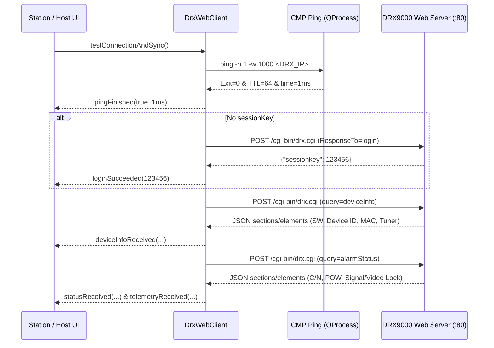

# 🌐 NETA DRX9000 Antenna Test Automation — REST / Web CGI API and Network Guide

> [!IMPORTANT]
> **Summary:** This document explains the **NETA DRX9000 Antenna Test Automation** network system. It covers communication with **DRX9000 satellite receivers** over **CAT6 Ethernet Web CGI** and the **LAN TCP/UDP** protocol between Host and Stations.

---

## 1. Network Architecture Overview

The system uses two network layers:

1. **Device Layer (HTTP / Web CGI + ICMP Ping):**
   - Station PCs connect directly to the antenna receiver (**DUT DRX9000**) via **CAT6 Ethernet**.
   - In Algorithm 2 (or on Host in Algorithm 1), it connects to the **Reference Golden DRX9000** receiver.
   - C++ Class: `Ethernet` (`public DataTransfer`) in `src/hardware/data_transfer.h` and `.cpp`.
   - The RS232 serial port (`RS232`) is only an optional backup in Engineer Settings. It is not used in normal production.
2. **Coordination Layer (LAN TCP :9100 + UDP Beacon :9101):**
   - **Algorithm 1 (`NETA_ALGORITMA_1_FOUR_PC`):** 1 Host PC + 3 Station PCs. Uses UDP Beacon for auto-discovery (`UdpBeaconBroadcaster` / `UdpBeaconListener`), and TCP for commands, reference lock, and live telemetry.
   - **Algorithm 2 (`NETA_ALGORITMA_2_THREE_PC`):** 3 Station PCs without Host PC. Stations connect to Reference DRX via Web CGI, using MariaDB `reference_lock` table for atomic queue locking.

---

## 2. DRX9000 Ethernet Ping & Web CGI Lifecycle

### 2.1 ICMP Ping Connection Check
When the app starts, when the operator clicks **Ping & Connect (ETH)**, and every **8 seconds** in background:
- `DrxWebClient::pingHost(int timeoutMs = 1000)` runs system ping asynchronously via `QProcess` (`Windows: ping -n 1 -w <ms> <IP>`).
- Validates real ICMP response with `TTL=` check (`output.contains("TTL=")`) to avoid false positives.
- Parses round-trip latency (`time=...ms`) and emits signal `pingFinished(bool reachable, int latencyMs, QString hostIp)`.
- If connection is lost, `resetSession()` is called to clear stale session keys.

### 2.2 Connection and Sync Flow (`testConnectionAndSync`)



---

## 3. DRX9000 Web CGI HTTP/JSON API Reference

All HTTP requests use the following standard parameters:

| Property | Value |
|---|---|
| **Full URL** | `http://<DRX_IP>:<PORT>/cgi-bin/drx.cgi` (Default port: `80`) |
| **HTTP Method** | `POST` |
| **Content-Type** | `application/x-www-form-urlencoded` |
| **User-Agent** | `NETA-DRX9000-Automator` |
| **Body Format** | Key-value pairs separated by newline (`\n`) |
| **Request Timeout** | `3000 ms` |

### 3.1 Login (`ResponseTo=login`)
A dynamic `sessionkey` is required before tuning frequencies or reading telemetry.

**Request Body:**
```text
ResponseTo=login
sessionKey=
lg_username=admin
lg_password=1234
```

**Success Response:**
```json
{
  "sessionkey": 482910
}
```

**Automatic Re-Authentication:**
- If the receiver returns `{"access": "denied"}` or TCP connection resets, `m_sessionKey` is cleared to 0.
- The pending action (`STATUS`, `DEVICE_INFO`, `TUNE`) is stored in buffer, and executed automatically as soon as login succeeds.

---

### 3.2 Tuning Frequency (`ResponseTo=freq`)
Sent on each channel change during test (`TestStateMachine::runCurrentChannel()`) and during Golden Sample calibration.

**Unit Conversions (`DrxWebClient::sendTune`):**
- If `freqMHz < 50000`, it converts to **kHz** (`freqMHz * 1000`, e.g. `11054` → `11054000`).
- If `symbolRate < 100000`, it converts to **Bd/s** (`symbolRate * 1000`, e.g. `30000` → `30000000`).
- `polarity`: `1` for Horizontal (`'H'`), `0` for Vertical (`'V'`).

**Request Body:**
```text
ResponseTo=freq
sessionKey=482910
fr_frequency=11054000
fr_srate=30000000
fr_pol=0
```

---

### 3.3 Live RF Telemetry and Lock Status (`query=alarmStatus`)
Polled every `450 ms` while waiting for lock, and every `250 ms` during sampling (`300 ms` on Host live stream).

**Request Body:**
```text
query=alarmStatus
sessionKey=482910
```

**Response JSON Elements:**
Parsed by `extractElements()` which flattens `sections[].elements[]`:

| `domid` | Alternative `caption` | Example Raw Value | Parsed Output |
|---|---|---|---|
| `st_current_time` | `time` | `"08:15:42"` | Timestamp |
| `st_channel` | `channel` | `"TRT 1 HD"` | `channelName` (String) |
| `st_signal` | `signal` | `"tick"` / `"cross"` / `"1"` / `"0"` | `sigLock` (`bool`) |
| `st_video` | `video` | `"tick"` / `"cross"` | `vidLock` (`bool`) |
| `st_audio` | `audio` | `"tick"` / `"cross"` | `audLock` (`bool`) |
| `st_cn` | `c/n`, `cn` | `"14.6 dB"` | `cn` (`double`, dB) |
| `st_power` | `power` | `"- 39.2 dBm"` | `pwr` (`double`, dBm) |
| `st_ber` | `ber` | `"1.0E-7"` | `ber` (`double`) |
| `st_ebn0` | `ebn0`, `eb/n0` | `"11.4 dB"` | `ebn0` (`double`) |

---

### 3.4 Device Information (`query=deviceInfo`)
Retrieves software version, device serial ID, MAC address, and tuner model.

**Request Body:**
```text
query=deviceInfo
sessionKey=482910
```

---

## 4. LAN TCP (:9100) and UDP Beacon (:9101) Protocol

In Algorithm 1 (`NETA_ALGORITMA_1_FOUR_PC`), the Host (`HostWindow` + `TcpServer`) and Stations (`ClientWindow` + `TcpClient`) communicate via JSON messages (`src/network/network_messages.h`).

### 4.1 UDP Lobby Discovery (`Port 9101`)
- Host broadcasts `NETA_BEACON` every `2000 ms` on LAN.
- Station `UdpBeaconListener` receives the beacon, discovers the Host IP, and connects to TCP port `:9100`.

### 4.2 TCP Message Framing (`Port 9100`)
- Single line compact JSON + newline (`\n`).

| Message Type | Direction | Description |
|---|---|---|
| `REGISTER` | Station → Host | Station register: `station_id`, `station_name` |
| `REGISTER_ACK` | Host → Station | Acknowledgment: `status="OK"`, `ref_mode`, `server_time` |
| `REF_MODE_UPDATE` | Host → All Stations | Broadcast when Admin changes reference mode (`"LIVE"` / `"GOLDEN"`) |
| `HEARTBEAT` | Station → Host | Every 3 sec: `station_id`, `state`, `channel_no`, `antenna_sn` |
| `LOCK_REQ` | Station → Host | Station requests mutex lock on Reference Antenna: `timeout_sec` (default 90) |
| `LOCK_GRANTED` | Host → Station | Lock granted: `station_id`, `timeout_sec` |
| `LOCK_WAITING` | Host → Station | Placed in queue (FIFO): `queue_position`, `active_station_id` |
| `LOCK_RELEASE` | Station → Host | Station finishes test and releases lock |
| `LOCK_RELEASED` | Host → Station | Release confirmed |
| `LOCK_EXPIRED` | Host → Station | Lock guard timeout warning |
| `REF_TUNE` | Station → Host | Active lock holder requests reference tune to transponder channel |
| `REF_DATA` | Host → Active Station | Stream of live Reference DRX telemetry: `ref_cn`, `ref_pow`, `carrier_locked`, `video_locked` |

---

## 5. Source Code References

- `src/hardware/data_transfer.h` / `src/hardware/data_transfer.cpp` (`DataTransfer`, `Ethernet`, `RS232`)
- `src/network/network_messages.h`
- `src/network/tcp_server.h` / `src/network/tcp_server.cpp`
- `src/network/tcp_client.h` / `src/network/tcp_client.cpp`
- `src/network/udp_beacon.h` / `src/network/udp_beacon.cpp`
- `src/core/test_state_machine.h` / `src/core/test_state_machine.cpp`
