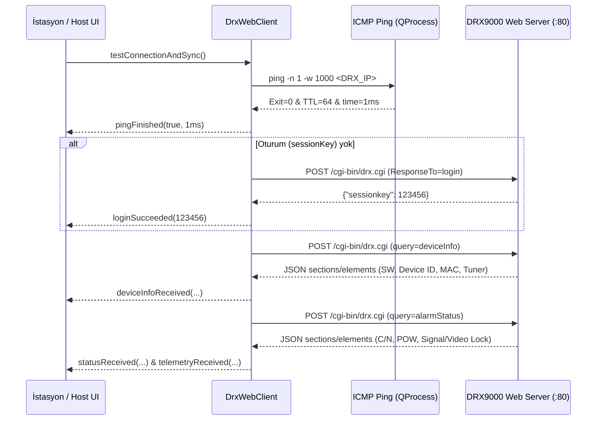

# 🌐 NETA DRX9000 Anten Test Otomasyonu — REST / Web CGI API ve Ağ Haberleşme Rehberi

> [!IMPORTANT]
> **Kısa Proje Hatırlatması:** Bu doküman, **NETA DRX9000 Antenna Test Automation** projesinin (3 istasyonlu üretim hattı + merkezi yönetici sunucu / dağıtık mimari) sahadaki **DRX9000 uydu alıcıları** ile **CAT6 Ethernet Web CGI** üzerinden kurduğu birincil haberleşmeyi ve istasyonlar ile yönetici arasındaki **LAN TCP/UDP** protokolünü ayrıntılı olarak belgeler.

---

## 1. Haberleşme Mimarisine Genel Bakış

Proje iki katmanlı ağ haberleşmesi kullanır:

1. **Cihaz Katmanı (HTTP / Web CGI + ICMP Ping):**
   - İstasyon PC'leri test edilen antene bağlı **DUT DRX9000** cihazıyla (ve Yönetici Host veya Alg-2'de **Referans Golden DRX9000** cihazıyla) doğrudan **CAT6 Ethernet** üzerinden haberleşir.
   - Uygulama sınıfı: `Ethernet` (`public DataTransfer`) (`src/hardware/data_transfer.h`, `src/hardware/data_transfer.cpp`).
   - RS232 seri port (`RS232 : public DataTransfer`) yalnızca Mühendis Ayarları sekmesinde opsiyonel laboratuvar yedeği olarak bulunur; ana üretim akışında kullanılmaz.
2. **Koordinasyon Katmanı (LAN TCP :9100 + UDP Beacon :9101):**
   - **Algoritma 1 (`NETA_ALGORITMA_1_FOUR_PC`):** 1 Yönetici (Host) + 3 Test İstasyonu arasında UDP keşif (`UdpBeaconBroadcaster` / `UdpBeaconListener`), TCP komut/kilit hakemi (`TcpServer` / `TcpClient`) ve gerçek zamanlı referans telemetri akışı yürütür.
   - **Algoritma 2 (`NETA_ALGORITMA_2_THREE_PC`):** Yönetici PC olmadan istasyonlar referans DRX ile doğrudan Web CGI üzerinden konuşur; kilit koordinasyonu MariaDB `reference_lock` tablosuyla sağlanır.

---

## 2. DRX9000 Ethernet Ping & Web CGI Yaşam Döngüsü

### 2.1 ICMP Ping Öncelikli Bağlantı Doğrulama
Uygulama açılışında, **Ping & Bağlan (ETH)** butonuna basıldığında ve her **8 saniyede bir** arka plan kalp atışı sırasında cihaz erişilebilirliği doğrulanır:

- `DrxWebClient::pingHost(int timeoutMs = 1000)` asenkron `QProcess` ile işletim sisteminin `ping` komutunu çalıştırır (`Windows: ping -n 1 -w <ms> <IP>`, `Linux: ping -c 1 -W <s> <IP>`).
- Windows `ping.exe` *"Destination host unreachable"* durumunda bile çıkış kodu `0` dönebildiği için çıktıda **gerçek ICMP `TTL=`** yanıtı aranır (`output.contains("TTL=", Qt::CaseInsensitive)`).
- RTT gecikmesi `time=...ms` / `süre=...ms` düzenli ifadesi ile ayrıştırılır ve `pingFinished(bool reachable, int latencyMs, QString hostIp)` sinyali yayınlanır.
- Cihaza erişim kesildiğinde `resetSession()` çağrılarak eski `sessionkey` sıfırlanır.

### 2.2 Bağlantı ve Veri Yenileme Zinciri (`testConnectionAndSync`)



---

## 3. DRX9000 Web CGI HTTP/JSON API Referansı

Tüm HTTP istekleri aşağıdaki ortak yapı ile gönderilir:

| Özellik | Değer |
|---|---|
| **Tam URL** | `http://<DRX_IP>:<PORT>/cgi-bin/drx.cgi` (varsayılan port: `80`) |
| **HTTP Metodu** | `POST` |
| **Content-Type** | `application/x-www-form-urlencoded` |
| **User-Agent** | `NETA-DRX9000-Automator` |
| **Gövde Biçimi** | Satır sonu (`\n`) ile ayrılmış `anahtar=değer` çiftleri |
| **Varsayılan İstek Zaman Aşımı** | `3000 ms` (`m_timeoutMs`) |

### 3.1 Oturum Açma (`ResponseTo=login`)
Cihaz üzerinde ayar yapmadan veya telemetri sorgulamadan önce dinamik `sessionkey` alınması zorunludur.

**İstek Gövdesi:**
```text
ResponseTo=login
sessionKey=
lg_username=admin
lg_password=1234
```

**Başarılı JSON Yanıtı:**
```json
{
  "sessionkey": 482910
}
```

**Otomatik Oturum Yenileme (Re-Auth):**
- Cihaz herhangi bir sorguya `{"access": "denied"}` döndürürse veya TCP bağlantısı reddedilirse/sıfırlanırsa (`ConnectionRefusedError`, `RemoteHostClosedError`), `m_sessionKey = 0` yapılır.
- Bekleyen işlem (`STATUS`, `DEVICE_INFO`, `TUNE`, `SYNC_CHAIN`) `m_pendingActionAfterLogin` / `m_pendingDataAfterLogin` tamponunda tutulur, `login()` tamamlandığı anda yeni `sessionkey` enjekte edilerek otomatik tekrarlanır.

---

### 3.2 Frekans & Transponder Ayarlama (`ResponseTo=freq`)
Test sırasındaki her kanal değişiminde (`TestStateMachine::runCurrentChannel()` ve Yönetici Golden Sample kalibrasyonunda) gönderilir.

**Birim Dönüşümleri (`DrxWebClient::sendTune`):**
- `freqMHz` değeri `< 50000` ise otomatik **kHz** birimine çevrilir (`freqMHz * 1000`, örn. `11054` → `11054000`).
- `symbolRate` değeri `< 100000` ise otomatik **Bd/s (sym/s)** birimine çevrilir (`symbolRate * 1000`, örn. `30000` → `30000000`).
- `polarity`: `'H'` ile başlıyorsa `1` (Horizontal), aksi halde `0` (Vertical).

**İstek Gövdesi:**
```text
ResponseTo=freq
sessionKey=482910
fr_frequency=11054000
fr_srate=30000000
fr_pol=0
```

**Sinyal:** Başarılı yanıtta `tuneCompleted(true, "Transponder tuned.")` yayılır.

---

### 3.3 Canlı RF Telemetri ve Kilit Durumu (`query=alarmStatus`)
Test sırasında taşıyıcı kilidi beklenirken `450 ms`, örnekleme sırasında `250 ms` (Host canlı yayınında `300 ms`) aralıklarla sorgulanır.

**İstek Gövdesi:**
```text
query=alarmStatus
sessionKey=482910
```

**Yanıt JSON Yapısı (Sections / Elements):**
DRX9000 CGI sunucusu alanları iç içe `sections[].elements[]` veya kök düzeyinde `elements[]` dizisi içinde döner. `extractElements()` yardımcı fonksiyonu tüm elemanları düzleştirir ve her elemanın `domid` / `caption` / `value` alanlarını inceler:

| `domid` | Alternatif `caption` Anahtarları | Örnek Ham Değer | Dönüştürülen Çıktı |
|---|---|---|---|
| `st_current_time` | `saat`, `time` | `"08:15:42"` | Log zaman damgası |
| `st_channel` | `kanal`, `channel` | `"TRT 1 HD"` | Aktif kanal adı (`channelName`) |
| `st_signal` | `sinyal`, `signal` | `"tick"` / `"cross"` / `"1"` / `"0"` | `sigLock` (`bool`, `isDrxLockPositive`) |
| `st_video` | `video` | `"tick"` / `"cross"` | `vidLock` (`bool`) |
| `st_audio` | `audio`, `ses` | `"tick"` / `"cross"` | `audLock` (`bool`) |
| `st_cn` | `c/n`, `cn` | `"14.6 dB"` | `cn` (`double`, dB) |
| `st_power` | `güç`, `gucu`, `power` | `"- 39.2 dBm"` | `pwr` (`double`, dBm) |
| `st_ber` | `ber` | `"1.0E-7"` | `ber` (`double`) |
| `st_ebn0` | `ebn0`, `eb/n0` | `"11.4 dB"` | `ebn0` (`double`) |

**Özel Ayrıştırma Kuralları:**
- `parseDrxNumeric()`: `"- 39 dBm"` gibi eksi işaretinden sonra boşluk bulunan değerlerdeki boşluğu temizler (`[-+]\s+`), `,` karakterini `.` ile değiştirir ve bilimsel gösterimi (`1.0E-7`) destekler.
- `isDrxLockPositive()`: `"tick"`, `"ok"`, `"true"`, `"1"`, `"yes"`, `"*lock*"` değerlerini kilitli (`true`); `"cross"`, `"?"`, `"0"`, `"false"`, `"unlocked"` değerlerini kilitsiz (`false`) olarak değerlendirir.

**Yayılan Sinyaller:**
- `statusReceived(bool signalLocked, bool videoProducing, bool audioProducing, QString channelName)`
- `telemetryReceived(double powerDbm, double cnDb, double ber, double ebN0)`

---

### 3.4 Cihaz Kimlik Bilgisi (`query=deviceInfo`)
Ping/Login doğrulaması sonrası istasyon kartına yazılım sürümü, cihaz seri kimliği, MAC adresi ve tuner modelini getirir.

**İstek Gövdesi:**
```text
query=deviceInfo
sessionKey=482910
```

**Ayıklanan Alanlar (`handleDeviceInfoResponse`):**
- `sw` / `yazılım` / `versiyon` → `swVersion`
- `cihaz id` / `device id` / `devid` → `deviceId`
- `mac` → `mac`
- `tuner` → `tunerModel`

**Yayılan Sinyal:** `deviceInfoReceived(swVersion, deviceId, mac, tunerModel)`.

---

### 3.5 Ham CGI Sorgusu (`sendRawQuery`)
Geliştirici ve hata ayıklama konsolunda (`DebugRunnerWindow`) özel CGI sorgularını test etmek için kullanılır:
```text
query=<queryString>
sessionKey=<m_sessionKey>
```
Ham yanıt baytları `rawResponseReceived(actionType, payload)` sinyaliyle dışarı aktarılır.

---

## 4. LAN TCP (:9100) ve UDP Beacon (:9101) Koordinasyon Protokolü

Algoritma 1 (`NETA_ALGORITMA_1_FOUR_PC`) modunda Yönetici Sunucu (`HostWindow` + `TcpServer`) ve 3 Test İstasyonu (`ClientWindow` + `TcpClient`) aşağıdaki JSON protokolü ile haberleşir (`src/network/network_messages.h`).

### 4.1 UDP Lobi Keşfi (`Port 9101`)
- Host `2000 ms` aralıkla LAN ağına `NETA_BEACON` UDP yayını gönderir.
- İstasyon `UdpBeaconListener` bu paketi yakaladığında Host IP'sini otomatik öğrenir, `AppConfig` üzerine kaydeder ve `:9100` TCP portuna bağlanır.

### 4.2 TCP Komut & Telemetri Çerçeve Formatı (`Port 9100`)
- Taşıma formatı: Tek satır **Compact UTF-8 JSON** + `\n` (`NetMsg::serialize` / `NetMsg::deserialize`).

| Mesaj Tipi (`type`) | Yön | Açıklama ve JSON Alanları |
|---|---|---|
| `REGISTER` | İstasyon → Host | İstasyon kaydı: `station_id`, `station_name` |
| `REGISTER_ACK` | Host → İstasyon | Kayıt onayı: `status="OK"`, `ref_mode` (`"LIVE"` / `"GOLDEN"`), `server_time` |
| `REF_MODE_UPDATE` | Host → Tüm İstasyonlar | Yönetici referans modunu değiştirdiğinde yayınlanır: `ref_mode` (`"LIVE"` / `"GOLDEN"`) |
| `HEARTBEAT` | İstasyon → Host | 3 sn aralıkla canlı durum: `station_id`, `state`, `channel_no`, `antenna_sn` |
| `LOCK_REQ` | İstasyon → Host | Referans test izni/kilidi talebi: `station_id`, `timeout_sec` (vars. `90`) |
| `LOCK_GRANTED` | Host → İstasyon | Kilit/izin verildi: `station_id`, `timeout_sec` |
| `LOCK_WAITING` | Host → İstasyon | Sıraya alındı (FIFO): `station_id`, `queue_position`, `active_station_id` |
| `LOCK_RELEASE` | İstasyon → Host | Test bitimi veya iptalinde kilit bırakma: `station_id` |
| `LOCK_RELEASED` | Host → İstasyon | Kilit bırakma onayı |
| `LOCK_EXPIRED` | Host → İstasyon | Kilit güvenlik zaman aşımı uyarısı: `station_id`, `reason` |
| `REF_TUNE` | İstasyon → Host | Yalnızca `LiveReference` modunda ve aktif kilit sahibiyse Referans DRX'i ayarlar: `station_id`, `channel_no`, `freq`, `sr`, `pol` |
| `REF_DATA` | Host → Aktif İstasyon | Canlı Referans DRX telemetri akışı (`300 ms`): `station_id`, `ref_cn`, `ref_pow`, `carrier_locked`, `video_locked` |

### 4.3 Canlı Referans vs Golden Sample Modu Davranışı
- Yönetici **`LiveReference`** seçtiğinde `REF_TUNE` üzerine Host Referans DRX'i ilgili frekansa kilitler ve `REF_DATA` ile anlık C/N + Power akıtır.
- Yönetici **`GoldenSample`** (Referans anten yokken) seçtiğinde Host tüm istasyonlara `REF_MODE_UPDATE` (`ref_mode="GOLDEN"`) bildirir. İstasyonlar yine yöneticiden `LOCK_REQ` izni alır ancak test sırasında fiziksel Referans DRX'e tune atılmaz; `TestStateMachine` her transponder kanalının DB'de kayıtlı `goldenCnDb` ve `goldenPowDbm` değerlerini referans olarak kullanır.

---

## 5. İlgili Kaynak Dosyalar

- `src/hardware/data_transfer.h` / `src/hardware/data_transfer.cpp` (`DataTransfer`, `Ethernet`, `RS232`)
- `src/network/network_messages.h`
- `src/network/tcp_server.h` / `src/network/tcp_server.cpp`
- `src/network/tcp_client.h` / `src/network/tcp_client.cpp`
- `src/network/udp_beacon.h` / `src/network/udp_beacon.cpp`
- `src/core/test_state_machine.h` / `src/core/test_state_machine.cpp`
