# 🗄️ NETA DRX9000 Antenna Test Automation — Portable MariaDB and Database Architecture

> [!IMPORTANT]
> **Summary:** This document explains the **Portable MariaDB** database architecture, the `DbManager` C++ class, satellite profiles, **Golden Sample** tables, work orders, audit logging, and the **Algorithm 2** atomic distributed lock.

---

## 1. Portable MariaDB Infrastructure

The application includes a standalone portable MariaDB server in `tools/mariadb_portable/`:

- `bin/mysqld.exe`: Database server engine (`port=3306`, `bind-address=0.0.0.0`)
- `bin/mysql_install_db.exe`: Initializes system data tables automatically if `data/` does not exist on target machine.
- `bin/mysqladmin.exe`: Shuts down the server safely on application exit.
- `my.ini`: Configured with UTF-8 (`utf8mb4`) and InnoDB engine.
- Default installation directory: `{sd}\NETA\DRX9000_Antenna_Test` (`C:\NETA\DRX9000_Antenna_Test`), avoiding permission issues and allowing portable folder copying.

---

## 2. `DbManager` Connection Chain and SQLite Fallback

Managed by `DbManager` singleton (`src/database/db_manager.h` and `.cpp`):

1. **Driver Priority:**
   `QMYSQL` (primary) → `QODBC` → `QSQLITE` (`neta_local_fallback.db`).
2. **Automatic Local Startup:**
   If host is `127.0.0.1` and port `3306` is closed, `startPortableMariaDbIfPresent()` launches the portable MariaDB process.
3. **Seamless SQLite Safety Fallback:**
   If MariaDB is not reachable, the system automatically falls back to local SQLite (`neta_local_fallback.db`) so no test data is ever lost.
4. **UTF-8 Support:**
   Full `utf8mb4` character set support across MariaDB and Qt layers.

---

## 3. Database Schema Overview

```mermaid
erDiagram
    users {
        int id PK
        varchar username UK
        varchar password_hash
        varchar full_name
        enum role "ADMIN | OPERATOR"
        tinyint is_active
    }
    satellite_profiles {
        int id PK
        varchar profile_name UK
        varchar satellite_name
        varchar orbital_position
        decimal default_tolerance_db
        tinyint is_active
    }
    profile_channels {
        int id PK
        int profile_id FK
        tinyint channel_no
        varchar channel_name
        int frequency_mhz
        int symbol_rate
        enum polarization "V | H"
        decimal tolerance_db
        decimal golden_cn_db
        decimal golden_pow_dbm
        tinyint has_golden_sample
        timestamp golden_updated_at
    }
    work_orders {
        int id PK
        varchar order_no UK
        varchar customer_name
        varchar product_code
        int satellite_profile_id
        int target_quantity
        int completed_quantity
        int passed_quantity
        int failed_quantity
        enum status
    }
    test_runs {
        bigint id PK
        int work_order_id FK
        tinyint station_id
        int operator_id FK
        varchar tester_name
        varchar operator_username
        varchar antenna_sn
        int satellite_profile_id FK
        timestamp test_timestamp
        int duration_sec
        enum overall_result "PASS | FAIL | ABORTED"
        varchar fail_reason
        decimal avg_delta_db
        decimal max_delta_db
    }
    test_run_channels {
        bigint id PK
        bigint test_run_id FK
        tinyint channel_no
        varchar channel_name
        int frequency_mhz
        decimal dut_cn_avg
        decimal dut_pow_avg
        decimal ref_cn_avg
        decimal ref_pow_avg
        decimal delta_db
        varchar result
    }
    audit_logs {
        bigint id PK
        timestamp log_timestamp
        varchar action_type
        text details
        varchar operator_username
        int station_id
    }
    reference_lock {
        int id PK
        int locked_by_station
        int current_channel_no
        timestamp lock_acquired_at
        timestamp heartbeat_at
    }
    golden_frequencies {
        int id PK
        varchar label
        int frequency_mhz
        int symbol_rate
        enum polarization "V | H"
        decimal golden_cn_db
        decimal golden_pow_dbm
        decimal tolerance_db
        int duration_sec
        mediumtext sample_data
        timestamp updated_at
    }
    cluster_nodes {
        int id PK
        enum node_type "HOST_SERVER | STATION_CLIENT | WEB_SERVICE"
        varchar node_name
        varchar ip_address
        int port
        enum status "ONLINE | BUSY | OFFLINE"
        varchar active_test_sn
        varchar details
        timestamp last_seen
    }
```



---

## 4. Work Order Management

Administrators add and manage work orders from the Host dashboard (`HostWindow`):
- `order_no`: Unique order number (e.g. `NETA-2026-001`)
- `customer_name`: Client name
- `product_code`: Antenna product model
- `satellite_profile_id`: Assigned satellite profile
- `target_quantity`: Target production batch size
- `completed_quantity`: Processed antennas count
- `passed_quantity`: Approved antennas count
- `failed_quantity`: Rejected antennas count
- `status`: `PENDING`, `IN_PROGRESS`, `COMPLETED`

When a test run finishes on any Station, `incrementOrderCount(workOrderId, isPass)` automatically updates the counters in the database.

---

## 5. Audit Logging (`audit_logs`)

All critical events are recorded for traceability:
- `TEST_START`, `TEST_FINISHED`
- `ORDER_CREATED`, `ORDER_UPDATED`, `ORDER_STATUS_CHANGED`, `ORDER_DELETED`
- `PROFILE_SAVED`, `PROFILE_DELETED`
- `USER_LOGIN`, `USER_UPDATED`

Records can be viewed, filtered, and exported in `TestHistoryWidget` (Tab 3: Audit Logs).

---

## 6. Algorithm 2: Distributed Atomic Locking

In 3-PC mode (`NETA_ALGORITMA_2_THREE_PC`), where there is no Host PC, Station PCs coordinate access to the single Reference Antenna using the `reference_lock` table:

```sql
UPDATE reference_lock 
SET locked_by_station = :myStation,
    current_channel_no = 1,
    lock_acquired_at = NOW(),
    heartbeat_at = NOW()
WHERE id = 1 AND (locked_by_station = 0 OR heartbeat_at < NOW() - INTERVAL 90 SECOND);
```

If `rowCount() > 0`, the lock is granted. On test completion, `locked_by_station` is set back to 0.

---

## 7. Web-Based Enterprise Fleet & Database Management Platform

When MariaDB runs on a standalone server or in 3-PC architecture without a desktop Host PC, or when engineering teams need remote factory visibility, the system provides a full Enterprise Single-Page Application (SPA) directly from any web browser on the network.

### 🚀 Starting the Web Console
Double-click:
👉 `tools/mariadb_portable/start_web_db.bat`

This script:
1. Verifies MariaDB is running on port 3306 (starts it automatically if stopped).
2. Auto-provisions `neta_antenna_test` schema and seed data if missing.
3. Starts the zero-dependency Python web server (`web/neta_db_web.py`) on port 8080.
4. Automatically launches the browser at `http://localhost:8080`.

### 🌐 Enterprise Sidebar Modules
The platform features a modern dark-theme responsive sidebar with 8 dedicated operational modules:

1. **📊 Genel Panel (Dashboard):**
   - Real-time KPI summary (Total Tests, Pass Rate %, Today's Tests, Registered Host Servers, Active Stations).
   - Live Mutex Lock status banner (showing whether Station 1/2/3 is testing or Reference is free).
   - Recent test runs table with one-click drill-down inspection.

2. **🖥️ Sunucular & Donanım (Cluster Fleet Management):**
   - Monitors multi-host servers, test stations, and web nodes (`cluster_nodes`).
   - Dynamic real-time health indicator (`ONLINE` if heartbeat < 60s, `OFFLINE` if inactive).
   - Direct node details (IP, port, active antenna SN, role, last heartbeat).

3. **👥 Kullanıcı Yönetimi (User Management & RBAC):**
   - Shared authentication credentials with Qt desktop application (`users` table).
   - Full CRUD & Authorization: Add new user, update password, toggle active/inactive status, delete accounts (built-in admin protected).
   - **Role Switching:** One-click role toggle between `ADMIN` and `OPERATOR` with root administrator protection.

4. **📋 Test Geçmişi (Test Run History & Inspection):**
   - Filterable search across serial numbers, station IDs, dates, and test results.
   - Comprehensive test detail modal inspecting all 10 transponder channels with DUT vs REF measurements ($\Delta$ margin).

5. **📦 İş Emirleri (Production Work Orders):**
   - Factory batch production tracking (`work_orders`).
   - Visual progress bars, target vs completed counters, pass/fail distribution, and status management.

6. **🛰️ Uydu Profilleri & Frekans Matrisi (Satellite Profiles & Frequency Channels):**
   - **Profile Management:** Create new satellite profiles (name, satellite name, orbital position e.g. 42.0E, default RF tolerance), view and delete custom profiles.
   - **Interactive Channel & Frequency Matrix:** Select any profile, view channels, and add new transponder frequencies (Channel No, Name, Frequency in MHz, Symbol Rate in kS/s, Polarization V/H, tolerance in dB).
   - **Channel Deletion:** Remove deprecated or obsolete frequencies per profile.

7. **🗄️ Veritabanı & SQL Konsolu (Database & SQL Query Console):**
   - Raw table browser with instant column sorting, live pagination, and CSV export.
   - Interactive SQL Query Console supporting multi-line query execution via `F9` or `Ctrl+Enter`.

8. **📜 Denetim İzi (Audit Logs & Security Trail):**
   - Complete traceability of logins, logouts, work order updates, user creations, and test runs.

---

## 8. Golden Reference Measurements and Time-Series Data (`golden_frequencies`)

The `golden_frequencies` table supports two flexible reference paradigms:

1. **Fixed Reference Values:** Operators can type fixed baseline numbers (`golden_cn_db`, `golden_pow_dbm`, `tolerance_db`) without transponder frequency constraints.
2. **Audio-Style Live Recording:** Operators start an audio-like live session ("🔴 Canlı Ölçüm Kaydını Başlat") which streams telemetry from the connected Golden DRX9000 device at 200ms intervals. The session computes real-time averages and stores serialized curve points (`sample_data` as comma-separated values) along with the recorded duration (`duration_sec`).

Selecting any row in the Host UI or Station UI parses `sample_data` and renders an interactive `QCustomPlot` mini-graph visualizing the actual signal trajectory, baseline mean line, and tolerance envelope.
   - Traceable by operator username, originating station IP/ID, and timestamp.

