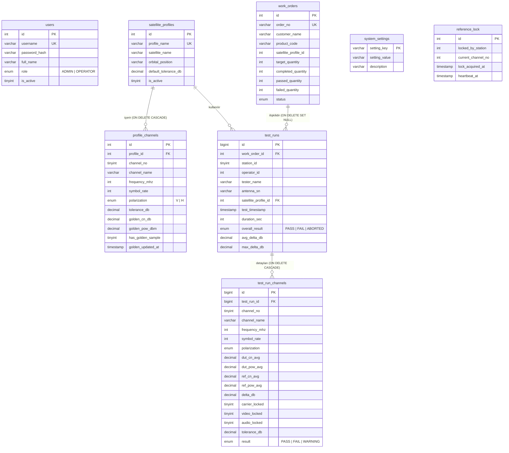

# 🗄️ NETA DRX9000 Anten Test Otomasyonu — Taşınabilir MariaDB ve Veritabanı Mimarisi

> [!IMPORTANT]
> **Kısa Proje Hatırlatması:** Bu doküman, **NETA DRX9000 Antenna Test Automation** projesinin merkezi veri katmanını yöneten **Taşınabilir MariaDB** sunucusunu, `DbManager` C++ arayüzünü, uydu/frekans profilleri ile **Golden Sample** tablolarını, zorunlu testçi kimliğini (`tester_name`) ve **Algoritma 2** atomik dağıtık kilit yapısını ayrıntılı olarak açıklar.

---

## 1. Taşınabilir MariaDB Altyapısı ve Kurulum Mimari

Sistem harici bir MySQL/MariaDB kurulumuna bağımlı olmadan kutudan çıktığı gibi çalışacak şekilde **Portable MariaDB** ile paketlenmiştir:

- **Konum:** `tools/mariadb_portable/`
  - `bin/mysqld.exe` — Veritabanı sunucu motoru (`port=3306`, `bind-address=0.0.0.0`)
  - `bin/mysql_install_db.exe` — Hedef PC'de `data/` klasörü yoksa sıfırdan temiz sistem tablolarını (`mysql`, `root@%` uzak erişim izni ve `neta123` şifresiyle) oluşturur
  - `bin/mysqladmin.exe` — Uygulama kapanışında güvenli servis durdurma (`shutdown`)
  - `my.ini` ve `data/my.ini` — UTF-8 (`utf8mb4`) ve InnoDB yapılandırması
- **Kurulum ve İzin Sorunsuz Taşınabilirlik:**
  - `tools/installer/neta_setup.iss`: Uygulama `Program Files` yerine **`{sd}\NETA\DRX9000_Antenna_Test` (`C:\NETA\DRX9000_Antenna_Test`)** dizinine, yönetici izni zorlamadan (`PrivilegesRequired=lowest`) kurulur. Böylece veritabanı `data/` yazma izin hatası yaşanmaz ve klasör başka bir PC'ye doğrudan kopyalanabilir.
  - `tools/deploy/build_and_package_release.ps1`: Release paketleme (`build.bat`) sırasında `OUTPUT/tools/mariadb_portable/data/` içindeki geliştirme verileri temizlenir (yalnızca `my.ini` korunur). Hedef makinede ilk açılışta `DbManager::startPortableMariaDbIfPresent()` otomatik olarak temiz veritabanını kurar.

---

## 2. `DbManager` Bağlantı Zinciri ve Türkçe Karakter (`utf8mb4`) Bütünlüğü

Veritabanı katmanı `DbManager` singleton sınıfı (`src/database/db_manager.h/.cpp`, bağlantı adı `"NetaMainDb"`) üzerinden yönetilir.

### 2.1 Sürücü Seçimi ve Otomatik Kurtarma
1. **Sürücü Önceliği:** `QMYSQL` (birincil, `sqldrivers/qsqlmysql.dll` + `libmysql.dll`) → `QODBC` → `QSQLITE` (`neta_local_fallback.db`).
2. **Yerel MariaDB Otomatik Başlatma:** Host `127.0.0.1` veya `localhost` ise ve port `3306` kapalıysa `startPortableMariaDbIfPresent()` çağrılır:
   - `data/mysql` dizini yoksa `mysql_install_db.exe --datadir=... --password=neta123 --allow-remote-root-access --port=3306 --silent` çalıştırılır.
   - `mysqld.exe --defaults-file=my.ini --datadir=data` başlatılır.
3. **Kimlik Yedekleri ve Şema Oluşturma:**
   - Erişim hatasında fabrika kimlikleri (`root/neta123`, `neta/neta123`) denenir.
   - `Unknown database` (Hata `1049`) durumunda sunucu köküne bağlanılıp `CREATE DATABASE IF NOT EXISTS neta_antenna_test CHARACTER SET utf8mb4 COLLATE utf8mb4_unicode_ci;` yürütülür.
   - `ensureDefaultDataIfMissing()` içinde tablolar yoksa `sql/schema_mysql.sql`, başlangıç kayıtları yoksa `sql/seed_data.sql` yüklenir.

### 2.2 Türkçe Karakter (`utf8mb4`) Yapılandırması
Türkçe karakterlerin (`ç, ğ, ı, İ, ö, ş, ü`) hem uygulama içinde hem MariaDB'de bozulmaması için dört katmanlı koruma uygulanır:
1. `my.ini`: `character-set-server=utf8mb4` ve `collation-server=utf8mb4_unicode_ci` (`[mysqld]` ve `[client]`).
2. `NETA_Antenna_Test.pro`: `QMAKE_CXXFLAGS += -finput-charset=UTF-8 -fexec-charset=UTF-8`.
3. `src/main.cpp`: `QTextCodec::setCodecForLocale(QTextCodec::codecForName("UTF-8"))`.
4. `DbManager::connectToDatabase()`:
   - Açılış öncesi: `db.setConnectOptions("MYSQL_OPT_SET_CHARSET_NAME=utf8mb4");`
   - Açılış sonrası: `SET NAMES 'utf8mb4'` ve `SET CHARACTER SET utf8mb4`.
   - `ensureDefaultDataIfMissing()` içinde önceki `latin1` oturumlarından kalmış olabilecek bozuk seed kayıtları (`%Ã%` / `%Â%` içeren) otomatik olarak temiz Türkçe karşılıklarıyla güncellenir.

---

## 3. İlişkisel Veritabanı Şeması (`neta_antenna_test`)

Tüm tablolar `InnoDB` motorunu ve `utf8mb4_unicode_ci` karakter kümesini kullanır (`sql/schema_mysql.sql`).



---

## 4. Tablo Detayları ve İş Kuralları

### 4.1 `users` (Giriş Yetkileri)
- Giriş ekranında (`LoginDialog`) Tekniker (`OPERATOR` → `UserRole::Technician`) ve Mühendis/Yönetici (`ADMIN` → `UserRole::Engineer`) ayrımını sağlar.
- Veritabanı kapalıysa dahi `DbManager::authenticateUser()` fabrika yedek hesaplarını (`admin/neta123`, `engineer/neta123`, `operator1..3/op123`, `tekniker/1234`) doğrular.

### 4.2 `satellite_profiles` ve `profile_channels` (Uydu Profilleri & Golden Sample)
- **İstasyon Yetkisi:** İstasyon ekranından yeni uydu profili eklenebilir, frekans (`950 - 14500 MHz`), sembol hızı (`1000 - 65000 kS/s`) ve polarizasyon (`V` / `H`) eklenip/düzenlenebilir. İstasyon düzenlemelerinde **`tolerance_db`**, **`golden_cn_db`**, **`golden_pow_dbm`**, **`has_golden_sample`** alanları gizlidir ve mevcut kayıtlı değerler korunur.
- **Yönetici Yetkisi:** `HostWindow` üzerinden hem toleransları hem Golden Sample değerlerini elle düzenleyebilir veya bağlı Referans DRX9000 üzerinden otomatik ölçüm alıp (`updateChannelGoldenSample`) veritabanına yazabilir.
- **Otomatik Şema Göçü:** Eski veritabanlarında `golden_cn_db` sütunu yoksa `ensureDefaultDataIfMissing()` otomatik `ALTER TABLE` ile sütunları ekler.

### 4.3 `test_runs` ve `test_run_channels` (Kalite Kayıtları)
- **`tester_name` (Zorunlu Testçi Adı):** Giriş kullanıcı adından (`operator_id` / login) bağımsızdır. Her test öncesi istasyonda zorunlu olarak doldurulur (`ClientWindow`), test kaydıyla birlikte saklanır ve Yönetici Geçmiş Tablosu + Excel çıktısında görüntülenir.
- `insertTestRun()` işlemi SQL `transaction` içinde yürütülür; `test_runs` ve tüm kanal satırları (`test_run_channels`) atomik olarak yazılır ve bağlı `work_orders` sayaçları (`completed_quantity`, `passed_quantity` veya `failed_quantity`) artırılır.

### 4.4 `system_settings` (Dinamik Sistem Parametreleri)
| Anahtar (`setting_key`) | Varsayılan | Açıklama |
|---|---|---|
| `REFERENCE_MODE` | `LIVE` | `LIVE` (Canlı Referans Anten) veya `GOLDEN` (Kayıtlı Golden Sample) — Yönetici belirler |
| `LOCK_TIMEOUT_SEC` | `90` | Referans kilidi emniyet zaman aşımı (saniye) |
| `SAMPLE_DURATION_SEC` | `5` | Kanal başına ortalama alma süresi (saniye) |
| `DEFAULT_TOLERANCE_DB` | `1.50` | Varsayılan C/N delta toleransı (dB) |
| `TCP_PORT` | `9100` | Host TCP komut portu |
| `UDP_BEACON_PORT` | `9101` | LAN UDP keşif portu |
| `REPORT_OUTPUT_DIR` | `reports` | Excel çıktı dizini |

### 4.5 `reference_lock` (Algoritma 2 — Atomik Dağıtık Kilit)
`NETA_ALGORITMA_2_THREE_PC` aktifken yönetici PC olmadan 3 istasyon arasında tek referans alıcıyı sırayla paylaştırmak için `id = 1` olan tek satırlık atomik mutex tablosu kullanılır:
- **Kilit Alma (`tryAcquireDbLock`):**
  ```sql
  UPDATE reference_lock
  SET locked_by_station = :sid,
      lock_acquired_at = CURRENT_TIMESTAMP,
      heartbeat_at = CURRENT_TIMESTAMP
  WHERE id = 1
    AND (locked_by_station = 0
         OR locked_by_station = :sid
         OR TIMESTAMPDIFF(SECOND, heartbeat_at, NOW()) > 45);
  ```
  `numRowsAffected() > 0` ise kilit kazanılır. Herhangi bir istasyon elektrik kesintisi/çökme yaşarsa 45 saniye sonunda `heartbeat_at` zaman aşımına düşerek kilit otomatik serbest kalır.
- **Canlılık Güncelleme (`updateDbLockHeartbeat`):** Her kanal geçişinde aktif kanal numarası ve `heartbeat_at` yenilenir.
- **Bırakma (`releaseDbLock`):** Test bittiğinde veya iptal edildiğinde `locked_by_station = 0, current_channel_no = 0` yapılır.

---

## 5. Algoritma 1 vs Algoritma 2 DB Kullanım Özeti

| Özellik | Algoritma 1 (`NETA_ALGORITMA_1_FOUR_PC`) | Algoritma 2 (`NETA_ALGORITMA_2_THREE_PC`) |
|---|---|---|
| **MariaDB Konumu** | Host PC üzerinde (`127.0.0.1` / LAN Host IP) | Sabit veritabanı sunucusu veya 1 numaralı PC |
| **Kilit Koordinasyonu** | Host TCP `LockArbiter` (FIFO Kuyruk) | MariaDB `reference_lock` tablosu (Atomik SQL) |
| **Referans Modu Dağıtımı** | TCP (`REGISTER_ACK` + `REF_MODE_UPDATE`) + DB | `system_settings` (`REFERENCE_MODE`) |
| **Test & Profil Verileri** | Merkezi MariaDB (`DbManager`) | Merkezi MariaDB (`DbManager`) |

---

## 6. Bağlantı Gereksinimleri ve Taşıma İpuçları

- **Gerekli Qt/MySQL DLL'leri:** Uygulama klasöründe `libmysql.dll` ve `sqldrivers/qsqlmysql.dll` (32-bit MinGW derlemesiyle uyumlu) bulunmalıdır; `build.bat` bunları otomatik olarak `OUTPUT/` içine kopyalar.
- **Ağ Paylaşımı (Çoklu PC):** Host PC'de MariaDB dışarıdan erişim için `0.0.0.0:3306` dinler (`my.ini` içinde `bind-address=0.0.0.0`). Güvenlik duvarında TCP `3306`, `9100` ve UDP `9101` portlarının açık olması gerekir.
- **Başka PC'ye Taşıma:** Uygulamayı `setup.bat` ile üretilen kurulum `.exe` dosyasıyla kurabilir veya kurulu klasörü doğrudan kopyalayabilirsiniz. Boş veritabanıyla sıfır kurulum yapıldığında ilk açılışta tüm tablolar, profiller ve kullanıcılar otomatik oluşturulur.
