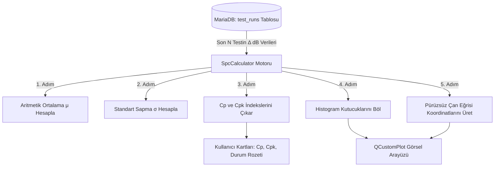

# 📊 Statistical Process Control (SPC) and Cpk Algorithm Guide
# İstatistiksel Süreç Kontrolü (SPC) ve Cpk Algoritması Kılavuzu

> Bu kılavuz; istatistik veya kalite kontrol geçmişi olmayan bir mühendis veya teknisyenin; Aritmetik Ortalama ($\mu$), Standart Sapma ($\sigma$), Gauss Çan Eğrisi (Normal Dağılım), Süreç Yeterlilik İndeksleri ($C_p$ ve $C_{pk}$) kavramlarını fabrika örnekleri, tablolar ve grafiklerle sıfırdan kavraması için hazırlanmıştır.

---

## 🎯 1. Giriş ve Gerçek Hayat Benzetmesi: "Hedefe Ok Atmak"

Düşünün ki bir hedef tahtasına **10 adet ok** atıyorsunuz. Hedef tahtasının tam ortasındaki kırmızı nokta **0 (Tam Hedef)** noktasıdır.

İki farklı okçu yarışıyor:

```text
               HEDEF TAHTASI (Tolerans Aralığı: -1.50 ile +1.50 arası)

             Sol Sınır (LSL)           TAM MERKEZ           Sağ Sınır (USL)
                 -1.50                    0.00                   +1.50
    ───────────────|───────────────────────🎯───────────────────────|───────────────
    Okçu A:                               xxx  xxx
    Okçu B:        x                                                x
```

* **Okçu A:** Bütün oklarını merkezin hemen etrafına (örneğin -0.1, +0.1, 0.0) kümelendirmiş.
* **Okçu B:** Bir okunu sol uçurumun ucuna (-1.4), bir okunu sağ uçurumun ucuna (+1.4) atmış.

Şimdi bu iki okçunun attığı yerlerin **düz aritmetik ortalamasını** alırsak ne görürüz?
* Okçu A'nın ortalaması: `0.00`
* Okçu B'nin ortalaması: `(-1.4 + 1.4) / 2 = 0.00`

Kağıt üzerinde iki okçu da **"Mükemmel, tam merkezde"** görünür! Fakat Okçu B'nin eli 2 milimetre titrese oku hedefin dışına (hurdaya) atacaktır. 

İşte **İstatistiksel Süreç Kontrolü (SPC)**, düz ortalamanın gizlediği bu büyük tehlikeleri matematiksel olarak açığa çıkarmak için geliştirilmiştir.

---

## 📡 NETA DRX9000 Anten Testinde Ne Ölçüyoruz?

NETA üretim hattında her bir anten döner tablaya konur ve uydudan gelen sinyal gücü ölçülür.

* **Altın Numune (Golden Sample):** Kusursuz olduğu laboratuvarda kanıtlanmış referans antenin sinyal seviyesidir.
* **Test Edilen Anten (DUT):** Fabrika bandından çıkan seri üretim anteni.
* **Fark Değeri ($\Delta\text{ dB}$):**
  $$\Delta\text{ dB} = \text{Test Edilen Anten (dBm)} - \text{Altın Anten (dBm)}$$

Fabrika Kalite Şartnamesi:
* **İdeal Hedef (Target):** $0.00\text{ dB}$ (Referans antenle birebir aynı güç).
* **Üst Tolerans Sınırı (USL - Upper Spec Limit):** $+1.50\text{ dB}$
* **Alt Tolerans Sınırı (LSL - Lower Spec Limit):** $-1.50\text{ dB}$
* $\Delta\text{ dB}$ değeri $-1.50$ ile $+1.50$ arasında kalan antenler **PASS (Geçti)**, dışına taşanlar **FAIL (Kaldı / Hurda)** olur.

---

## ❌ 2. Düz Aritmetik Ortalama ($\mu$) Neden Bizi Aldatır?

Aşağıdaki 3 farklı üretim hattından çıkan 4'er adet antenin test sonuçlarını inceleyelim:

| Test No | Hat A (Mükemmel Üretim) | Hat B (Tehlikeli / Sallantıda) | Hat C (Hatalı / Hurda Veren) |
| :--- | :---: | :---: | :---: |
| Anten 1 | $+0.10\text{ dB}$ | $+1.40\text{ dB}$ | $+2.00\text{ dB}$ *(HURDA)* |
| Anten 2 | $-0.10\text{ dB}$ | $-1.40\text{ dB}$ | $-2.00\text{ dB}$ *(HURDA)* |
| Anten 3 | $+0.20\text{ dB}$ | $+1.30\text{ dB}$ | $+1.80\text{ dB}$ *(HURDA)* |
| Anten 4 | $-0.20\text{ dB}$ | $-1.30\text{ dB}$ | $-1.80\text{ dB}$ *(HURDA)* |
| **Aritmetik Ortalama ($\mu$)** | **$0.00\text{ dB}$** | **$0.00\text{ dB}$** | **$0.00\text{ dB}$** |
| **Gözle Görülen Durum** | Kusursuz | Uçurumun Kenarında | 4'ü de çöpe gitti! |

> [!WARNING]
> **Düz Ortalama Tuzağı:** 
> Her üç hattın da ortalaması **$0.00\text{ dB}$**'dir. Eğer fabrika müdürü yalnızca ortalama rapora baksaydı, Hat C'deki tam bir fiyaskoyu ve Hat B'deki büyük savrulmayı asla göremeyecekti! Çünkü artı sapmalar ile eksi sapmalar birbirini sıfırlamıştır.

Bize artı ve eksilerin birbirini yok etmediği, verilerin **ne kadar saçıldığını** gösteren bir büyüklük gerekir: **Standart Sapma ($\sigma$)**.

---

## 📐 3. Standart Sapma ($\sigma$ - Sigma): Dağılma ve Saçılma Ölçüsü

Standart sapma; *"Ölçtüğümüz antenler, ortalama değerden ortalama kaç dB uzağa savruluyor?"* sorusunun cevabıdır.

### Neden Kare Alınır?
Sapmaları toplarken eksi değerler artıları götürmesin diye her farkın **karesi** alınır ($(-1.4)^2 = +1.96$). Böylece tüm sapmalar pozitif olur. En sonda da birimi orijinal haline döndürmek için **karekök** alınır.

### Formül (N Adet Ölçüm İçin):
$$\sigma = \sqrt{\frac{1}{N-1} \sum_{i=1}^{N} (x_i - \mu)^2}$$

### Adım Adım Sayısal Örnek:
Hat A'daki 3 anteni hesaplayalım: $x = [+0.10, -0.10, 0.00]$, Ortalama $\mu = 0.00$
1. Ortalamadan farkları bul: $(+0.10 - 0) = 0.10$, $(-0.10 - 0) = -0.10$, $(0.00 - 0) = 0.00$
2. Karelerini al: $0.10^2 = 0.01$, $(-0.10)^2 = 0.01$, $0.00^2 = 0.00$
3. Kareleri topla: $0.01 + 0.01 + 0.00 = 0.02$
4. $(N-1)$'e böl ($3-1=2$): $0.02 / 2 = 0.01$ (Buna **Varyans** denir)
5. Karekökünü al: $\sqrt{0.01} = \mathbf{0.10\text{ dB}}$ ($\sigma$)

Hat B için aynı hesap yapıldığında $\sigma = \mathbf{1.35\text{ dB}}$ çıkar!
* **$\sigma$ Küçükse ($0.10\text{ dB}$):** Üretim çok kararlı, robotlar ve lehimler milimetrik çalışıyor.
* **$\sigma$ Büyükse ($1.35\text{ dB}$):** Üretim savruluyor, tolerans dışına taşma an meselesi.

---

## 🔔 4. Gauss Çan Eğrisi ve Doğanın Kanunu ($6\sigma$ Kuralı)

Doğadaki ve sanayideki hemen hemen tüm ölçümler (boy uzunlukları, direnç değerleri, anten kazançları) çok sayıda test yapıldığında bir tepe noktası etrafında simetrik toplanır. Buna **Normal Dağılım** veya şeklinden ötürü **Gauss Çan Eğrisi** denir.

```text
                             GAUSS ÇAN EĞRİSİ
                                     ▲
                                    / \
                                   /   \
                                  /  |  \
                                 /   |   \
                                /    |    \
                              /      |      \
                           /         |         \
                     ----/           |           \----
                       -3σ   -2σ   -1σ   μ   +1σ   +2σ   +3σ
                      |◄────── %68.27 ──────►|
                      |◄──────────── %95.45 ────────────►|
                      |◄────────────────── %99.73 ──────────────────►|
```

İstatistiğin en büyük kuralı **$3\sigma$ ($6\sigma$) Kuralıdır**:
* Üretilen parçaların **%68.27**'si $[\mu - 1\sigma, \mu + 1\sigma]$ aralığına düşer.
* Üretilen parçaların **%95.45**'i $[\mu - 2\sigma, \mu + 2\sigma]$ aralığına düşer.
* Üretilen parçaların **%99.73**'ü $[\mu - 3\sigma, \mu + 3\sigma]$ aralığına düşer.

Toplam genişlik soldan sağa $3\sigma + 3\sigma = \mathbf{6\sigma}$ genişliğindedir. Bir fabrikanın ürettiği antenlerin neredeyse tamamı ($\%99.73$'ü) bu $6\sigma$'lık koridorun içindedir.

---

## 🚪 5. $C_p$ (Süreç Yeterliliği): "Garaj ve Araba" Benzetmesi

$C_p$, fabrikanın tolerans aralığı ile üretimin doğal dalgalanması arasındaki genişlik oranıdır.

* **Garaj Kapısının Genişliği:** Müşterinin izin verdiği tolerans aralığı $(\text{USL} - \text{LSL}) = 1.50 - (-1.50) = \mathbf{3.00\text{ dB}}$.
* **Arabanın Genişliği:** Fabrikanın ürettiği antenlerin kapladığı alan ($6\sigma$).

$$C_p = \frac{\text{USL} - \text{LSL}}{6\sigma} = \frac{\text{Tolerans Genişliği}}{\text{Süreç Yayılımı}}$$

```text
DURUM 1: Cp = 2.0 (Araba çok dar, garaj çok geniş. Sıfır kaza riski!)
[LSL ────────────────────────────── GARAJ KAPISI ────────────────────────────── USL]
                 [=== 6σ Üretim Yayılımı ===]

DURUM 2: Cp = 1.0 (Araba ile garaj kapısı aynı genişlikte. Aynalar kapıya sürtüyor!)
[LSL ────────────────────────────── GARAJ KAPISI ────────────────────────────── USL]
[================================== 6σ Üretim Yayılımı ==================================]

DURUM 3: Cp = 0.5 (Araba garajdan daha geniş! Duvara çarpma ve hurda kaçınılmaz!)
        [LSL ────────────────────── GARAJ KAPISI ────────────────────── USL]
[================================== 6σ Üretim Yayılımı ==================================]
```

### $C_p$'nin Gizli Kusuru Nedir?
$C_p$ harika bir genişlik ölçüsüdür fakat **arabanın garajın neresinde durduğuna bakmaz!**
Arabanız çok dar olabilir ($C_p = 2.0$), ama siz arabayı garajın sağ duvarına toslamışsanız araba duvara çarpar!

İşte bu yüzden $C_p$ tek başına yetersizdir, imdadımıza **$C_{pk}$** yetişir.

---

## 🛡️ 6. $C_{pk}$ (Süreç Performansı): Duvara Olan Mesafe

$C_{pk}$, hem yayılımı ($\sigma$) hem de sürecin merkezden sağa veya sola **kayıp kaymadığını ($\mu$)** hesaba katar.

Fabrika antenlerinin ortalaması tam $0.00\text{ dB}$ olmayabilir; örneğin antenler ortalama $+0.80\text{ dB}$ fazla kazanç veriyor olabilir (sağa kayma). Bu durumda antenler sağ sınıra ($+1.50\text{ dB}$) tehlikeli biçimde yaklaşmıştır.

$C_{pk}$ iki tarafı da ayrı ayrı inceler ve **en kötü (en küçük) olanı** seçer:

$$C_{pu} = \frac{\text{USL} - \mu}{3\sigma} \quad \text{(Üst duvara olan güvenlik mesafesi)}$$
$$C_{pl} = \frac{\mu - \text{LSL}}{3\sigma} \quad \text{(Alt duvara olan güvenlik mesafesi)}$$
$$C_{pk} = \min(C_{pu}, C_{pl})$$

> [!NOTE]
> **Neden $\min()$ Seçilir?**
> Bir zincir en zayıf halkası kadar güçlüdür. İster üst sınıra çarpın, ister alt sınıra; ürün hurda olur. $C_{pk}$, duvara en yakın olan tarafı baz alarak fabrikayı uyarır.

---

## 🏆 7. $C_{pk}$ Değerleri Ne Anlama Gelir? (Karar Tablosu)

| $C_{pk}$ Değeri | Renk / Durum | Anlamı ve Fabrikadaki Sonucu | Milyonda Hatalı Ürün (PPM) |
| :---: | :---: | :--- | :---: |
| **$C_{pk} < 1.00$** | 🔴 **Yetersiz (Bad)** | Üretim tolerans duvarlarına çarpıyor veya çok yakın. Hurda çıkması kaçınılmaz! Hat derhal durdurulmalı. | $> 2,700\text{ PPM}$ |
| **$1.00 \le C_{pk} < 1.33$** | 🟡 **Kritik (Marginal)** | Üretim sınırlara çok yakın geçiyor. En ufak bir sıcaklık veya malzeme değişiminde hurda üretir. İzlenmeli. | $63 - 2,700\text{ PPM}$ |
| **$1.33 \le C_{pk} < 1.67$** | 🟢 **Mükemmel (Capable)** | **Endüstri Standardı.** Süreç son derece kararlı ve güvenli. Tolerans koridorunun ortasında rahatça üretiliyor. | $< 63\text{ PPM}$ |
| **$C_{pk} \ge 1.67$** | 🏆 **World Class (6-Sigma)** | Dünya standartlarında üretim. Hata ihtimali milyonda birden azdır. | $< 1\text{ PPM}$ |

---

## 🚀 8. NETA DRX9000 Yazılımında Bu Algoritma Nasıl Çalışır?

Yazılımımıza eklediğimiz **SPC & Gauss Analiz Motoru (`SpcCalculator` & `SpcAnalysisWidget`)** şu adımlarla çalışır:



### Fabrika Mühendisi Bu Ekrandan Ne Anlar? (Erken Uyarı Sistemi)
1. **Çan Eğrisi Sağa Kaymışsa ($\mu > 0.30\text{ dB}$, $C_{pk} < 1.00$):**
   * Anten kablolarında veya LNB kazancında bir kayma var. Antenler henüz kalmadı (PASS alıyor olabilirler) fakat duvara yaklaşıyorlar. Mühendis 1 hafta sonra yaşanacak toplu hurda krizini **bugünden önler**.
2. **Çan Eğrisi Çok Basık ve Yayvansa ($\sigma > 0.50\text{ dB}$):**
   * Üretim bandında bir tutarsızlık var; operatör vidaları farklı torkla sıkıyor veya lehim sıcaklığı dalgalanıyor.
3. **Çan Eğrisi İnce, Sivri ve Tam Ortadaysa ($\mu \approx 0.00\text{ dB}$, $\sigma \approx 0.15\text{ dB}$, $C_{pk} \ge 1.67$):**
   * Üretim kusursuzdur. Kalite güvence sertifikası gururla müşteriye verilebilir.

---

## 📝 9. Özet Formül Tablosu

| Metrik | Adı | Formül | Amaç |
| :--- | :--- | :--- | :--- |
| **$\mu$** | Ortalama | $\frac{\sum x_i}{N}$ | Verilerin ağırlık merkezini gösterir. |
| **$\sigma$** | Standart Sapma | $\sqrt{\frac{\sum (x_i - \mu)^2}{N-1}}$ | Verilerin merkeze olan saçılma genişliğini ölçer. |
| **$C_p$** | Potansiyel Yeterlilik | $\frac{\text{USL} - \text{LSL}}{6\sigma}$ | Sürecin toleransa sığıp sığamayacağını ölçer (merkezi hesaba katmaz). |
| **$C_{pk}$** | Gerçek Yeterlilik | $\min\left(\frac{\text{USL} - \mu}{3\sigma}, \frac{\mu - \text{LSL}}{3\sigma}\right)$ | Sürecin en yakın duvara olan gerçek emniyet katsayısını hesaplar. |

---

## 🔢 10. Adım Adım Çözümlü 3 Gerçek Fabrika Senaryosu

Fabrika şartnamemiz sabit:
* **İdeal Hedef (Target):** $0.00\text{ dB}$
* **Alt Tolerans Sınırı (LSL):** $-1.50\text{ dB}$
* **Üst Tolerans Sınırı (USL):** $+1.50\text{ dB}$
* **Tolerans Koridoru Genişliği:** $\text{USL} - \text{LSL} = 1.50 - (-1.50) = \mathbf{3.00\text{ dB}}$

---

### 🟢 Senaryo 1: "Kusursuz Üretim" (Tam Merkezde ve Sıkı Dağılım)

Üretim bandından çıkan 5 antenin ölçülen $\Delta\text{ dB}$ değerleri:
$$x = [+0.10, -0.05, +0.05, -0.10, 0.00]\text{ dB}$$

**Adım 1: Aritmetik Ortalama ($\mu$)**
$$\mu = \frac{0.10 + (-0.05) + 0.05 + (-0.10) + 0.00}{5} = \frac{0.00}{5} = \mathbf{0.00\text{ dB}}$$

**Adım 2: Ortalamadan Farklar ve Standart Sapma ($\sigma$)**
* $(+0.10 - 0.00)^2 = 0.0100$
* $(-0.05 - 0.00)^2 = 0.0025$
* $(+0.05 - 0.00)^2 = 0.0025$
* $(-0.10 - 0.00)^2 = 0.0100$
* $(0.00 - 0.00)^2 = 0.0000$
* Kareler Toplamı $= 0.0100 + 0.0025 + 0.0025 + 0.0100 + 0.0000 = \mathbf{0.0250}$
* Varyans ($N-1=4$): $\frac{0.0250}{4} = 0.00625$
* Standart Sapma: $\sigma = \sqrt{0.00625} \approx \mathbf{0.079\text{ dB}}$

**Adım 3: $C_p$ (Kapasite Genişliği)**
$$C_p = \frac{1.50 - (-1.50)}{6 \times 0.079} = \frac{3.00}{0.474} \approx \mathbf{6.33}$$

**Adım 4: $C_{pk}$ (Gerçek Güvenlik Mesafesi)**
* Üst duvara mesafe: $C_{pu} = \frac{1.50 - 0.00}{3 \times 0.079} = \frac{1.50}{0.237} \approx 6.33$
* Alt duvara mesafe: $C_{pl} = \frac{0.00 - (-1.50)}{3 \times 0.079} = \frac{1.50}{0.237} \approx 6.33$
* $C_{pk} = \min(6.33, 6.33) = \mathbf{6.33}$

> **Yorum:** $C_{pk} \ge 1.67$ olduğu için süreç **6-Sigma (Kusursuz)** seviyesindedir. Fabrika arabayı devasa bir garajın tam ortasına milimetrik park etmiştir. Sıfır hurda riski!

---

### 🟡 Senaryo 2: "Sinsi / Riskli Üretim" (Dar Saçılma ama Sağa Kaymış - Sınırın Dibinde!)

Operatör anten vidalarını fazla sıkmış veya LNB kazancı kaymıştır. Ölçülen 5 anten:
$$x = [+1.20, +1.25, +1.15, +1.20, +1.30]\text{ dB}$$

> [!IMPORTANT]
> **DİKKAT:** 5 antenin hepsi de $[-1.50, +1.50]$ aralığında olduğu için geleneksel kalite kontrolde **hepsi PASS alır!** Düz mantık "üretim harika gidiyor" der. Şimdi matematiğin gerçeği nasıl yakaladığına bakalım:

**Adım 1: Aritmetik Ortalama ($\mu$)**
$$\mu = \frac{1.20 + 1.25 + 1.15 + 1.20 + 1.30}{5} = \frac{6.10}{5} = \mathbf{+1.22\text{ dB}}$$

**Adım 2: Ortalamadan Farklar ve Standart Sapma ($\sigma$)**
* $(1.20 - 1.22)^2 = (-0.02)^2 = 0.0004$
* $(1.25 - 1.22)^2 = (+0.03)^2 = 0.0009$
* $(1.15 - 1.22)^2 = (-0.07)^2 = 0.0049$
* $(1.20 - 1.22)^2 = (-0.02)^2 = 0.0004$
* $(1.30 - 1.22)^2 = (+0.08)^2 = 0.0064$
* Kareler Toplamı $= 0.0130$
* Varyans ($4$): $\frac{0.0130}{4} = 0.00325$
* Standart Sapma: $\sigma = \sqrt{0.00325} \approx \mathbf{0.057\text{ dB}}$

**Adım 3: $C_p$ (Tolerans Genişliğine Göre Durum)**
$$C_p = \frac{3.00}{6 \times 0.057} = \frac{3.00}{0.342} \approx \mathbf{8.77}$$
*(Gördüğünüz gibi $C_p$ muhteşem çıktı! Çünkü antenler birbirine çok yakın üretiliyor.)*

**Adım 4: $C_{pk}$ (Duvara Olan Mesafe) Gerçeği Haykırıyor!**
* Alt duvara mesafe: $C_{pl} = \frac{1.22 - (-1.50)}{3 \times 0.057} = \frac{2.72}{0.171} \approx 15.9$ (Sol duvar çok uzakta, rahatız)
* Üst duvara mesafe: $C_{pu} = \frac{1.50 - 1.22}{3 \times 0.057} = \frac{0.28}{0.171} \approx \mathbf{0.55}$ (Sağ duvara çarpmak üzereyiz!)
* $$C_{pk} = \min(15.9, \mathbf{0.55}) = \mathbf{0.55}$$

> **Yorum:** $C_{pk} = 0.55 < 1.00$ 🔴 **ALARM!**
> Bütün antenler PASS almasına rağmen $C_{pk}$ kırmızı alarm verir. Fabrika mühendisi hava sıcaklığı veya operatör yorgunluğu yüzünden bir sonraki partinin duvara çarpıp hurda olacağını **bugünden görür** ve kalibrasyonu derhal 1 dB geriye çeker!

---

### 🔴 Senaryo 3: "Hatalı ve Savrulan Üretim" (Ortalama Sıfır ama Yayılım Aşırı Geniş - Hurda Veren)

Torna tezgahında aşınma var veya lehim torku rastgele uygulanıyor. Ölçülen 5 anten:
$$x = [+1.40, -1.60\text{ (FAIL)}, +0.20, -1.30, +1.80\text{ (FAIL)}]\text{ dB}$$

**Adım 1: Aritmetik Ortalama ($\mu$)**
$$\mu = \frac{1.40 - 1.60 + 0.20 - 1.30 + 1.80}{5} = \frac{0.50}{5} = \mathbf{+0.10\text{ dB}}$$
*(Düz ortalamaya baksanız +0.10 dB ile her şey yolunda sanırsınız!)*

**Adım 2: Standart Sapma ($\sigma$)**
* $(1.40 - 0.10)^2 = 1.30^2 = 1.69$
* $(-1.60 - 0.10)^2 = (-1.70)^2 = 2.89$
* $(0.20 - 0.10)^2 = 0.10^2 = 0.01$
* $(-1.30 - 0.10)^2 = (-1.40)^2 = 1.96$
* $(1.80 - 0.10)^2 = 1.70^2 = 2.89$
* Kareler Toplamı $= 9.44$
* Varyans ($4$): $\frac{9.44}{4} = 2.36$
* Standart Sapma: $\sigma = \sqrt{2.36} \approx \mathbf{1.536\text{ dB}}$

**Adım 3 ve 4: $C_p$ ve $C_{pk}$**
$$C_p = \frac{3.00}{6 \times 1.536} = \frac{3.00}{9.216} \approx \mathbf{0.32}$$
$$C_{pu} = \frac{1.50 - 0.10}{3 \times 1.536} = \frac{1.40}{4.608} \approx 0.30$$
$$C_{pl} = \frac{0.10 - (-1.50)}{3 \times 1.536} = \frac{1.60}{4.608} \approx 0.35$$
$$C_{pk} = \min(0.30, 0.35) = \mathbf{0.30}$$

> **Yorum:** $C_{pk} = 0.30 \lll 1.00$ 🔴 **KRİTİK HATA!**
> Araba garaj kapısından 3 kat daha geniştir! 5 antenden 2'si doğrudan hurda olmuştur. Üretim hattı acilen durdurulmalıdır.

